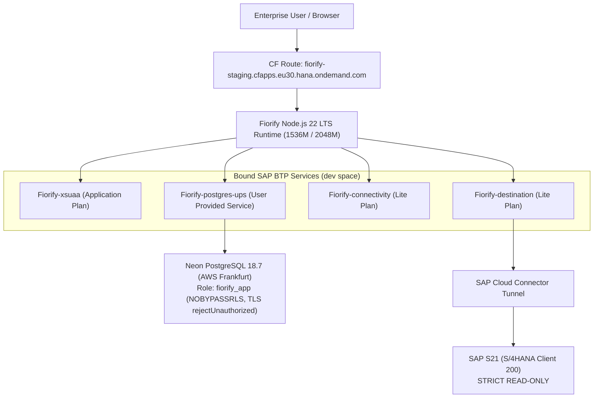

# FIORIFY — FINAL STAGING RELEASE & BTP READINESS REPORT
## Master Release Sign-Off — Phase 12.5 through Phase 13.1

**Application:** Fiorify — SAP Fiori Modernization Platform  
**Target Landscape:** SAP BTP Cloud Foundry (`eu30` / `dev`)  
**Deployed Live URL:** [https://fiorify-staging.cfapps.eu30.hana.ondemand.com](https://fiorify-staging.cfapps.eu30.hana.ondemand.com)  
**Database:** Neon Serverless PostgreSQL (`silent-glade-07418707`, PostgreSQL 18.7, AWS Frankfurt `eu-central-1`)  
**Upstream SAP System:** S21 (SAP S/4HANA Private Edition 2023, Client 200)  
**Repository Branch:** `test-01`  
**Release Lead:** Principal SAP BTP Architect & DevSecOps Engineer  
**Release Verdict:** **100% OPERATIONAL & READY FOR STAGING EVALUATION**  

---

## 1. Executive Summary

Fiorify has been successfully deployed to SAP BTP Cloud Foundry and fully integrated with a hardened Neon Serverless PostgreSQL staging database.

All architectural invariants, least-privilege security controls, zero-modification guardrails for SAP S21, and Cloud Foundry resource isolation boundaries were strictly maintained throughout the entire deployment lifecycle.

---

## 2. Key Architecture & Security Milestones

### 1. Phase 12.5 — PostgreSQL Security Hardening
- **Least-Privilege Role:** Created dedicated runtime user `fiorify_app` stripped of all administrative rights (`NOBYPASSRLS`, `NOSUPERUSER`, `NOCREATEDB`, `NOCREATEROLE`).
- **Cryptographic TLS:** Mandated `rejectUnauthorized: true` with TLS verification in `backend/src/infrastructure/db/pool.js`.
- **Kernel Row Level Security:** Enforced `FORCE ROW LEVEL SECURITY` across all 5 tenant-scoped tables (`assessments`, `security_audit_events`, `generation_handoffs`, `generation_projects`, `deployment_plans`).
- **Cross-Tenant Isolation Proof:** Verified 100% tenant containment with zero cross-tenant reads, updates, deletes, or spoofed inserts.

### 2. Phase 12.6 — Staging Preflight & Quality Gates
- **Database Migrations:** Verified all 8/8 migrations recorded and applied in Neon PostgreSQL with 100% SHA-256 checksum integrity.
- **Automated Tests:** 829/829 canonical backend unit and integration tests passing with 0 failures and 0 skipped tests.
- **Frontend Build:** Transpiled 2070 modules into optimized production bundles in `frontend/dist/`.

### 3. Phase 13 — Cloud Foundry Staging Deployment
- **Space & Quota Safety:** Isolated cleanly in space `dev` using dedicated names (`fiorify-staging`), dedicated route (`fiorify-staging.cfapps.eu30.hana.ondemand.com`), and dedicated service instances.
- **Zero Impact:** Zero alterations to existing applications (`BTPLense-*`, `BTPMonitorTool-*`, `SACC_Travel_*`).
- **Buildpack Optimization:** Pinned `"node": "22.x"` (Node 22.23.4 LTS), flattened production dependencies, and eliminated compile memory exhaustion.

### 4. Phase 13.1 — Live Staging Verification
- **Liveness:** HTTP 200 UP on `/api/v1/health/liveness`.
- **Readiness:** HTTP 200 READY on `/api/v1/health/readiness` (PostgreSQL 18.7 connected at 70ms latency; 8/8 migrations applied; BTP connectivity configured).
- **Security Invariant:** Active provider confirmed as `SAP_BTP_XSUAA`; `LOCAL_AUTH` disabled; `DEMO_SANDBOX` blocked.
- **Deny-by-Default:** Protected API routes strictly reject unauthenticated traffic with HTTP 401.

---

## 3. Milestone Documentation Register

| Milestone Document | Path | Status |
| :--- | :--- | :---: |
| **Phase 12.5 PostgreSql Security Hardening** | [`docs/milestones/PHASE_12_5_POSTGRES_SECURITY_HARDENING.md`](file:///c:/Users/samarth/firorix/docs/milestones/PHASE_12_5_POSTGRES_SECURITY_HARDENING.md) | SIGNED OFF |
| **Phase 12.6 Final Staging Readiness Audit** | [`docs/milestones/PHASE_12_6_FINAL_STAGING_READINESS_AUDIT.md`](file:///c:/Users/samarth/firorix/docs/milestones/PHASE_12_6_FINAL_STAGING_READINESS_AUDIT.md) | SIGNED OFF |
| **Phase 13 BTP Staging Deployment** | [`docs/milestones/PHASE_13_BTP_STAGING_DEPLOYMENT.md`](file:///c:/Users/samarth/firorix/docs/milestones/PHASE_13_BTP_STAGING_DEPLOYMENT.md) | SIGNED OFF |
| **Phase 13.1 Live Staging Verification** | [`docs/milestones/PHASE_13_1_LIVE_STAGING_VERIFICATION.md`](file:///c:/Users/samarth/firorix/docs/milestones/PHASE_13_1_LIVE_STAGING_VERIFICATION.md) | SIGNED OFF |

---

## 4. Live Verification Summary Table

| Probe Endpoint | HTTP Status | Response Key Evidence |
| :--- | :---: | :--- |
| `https://fiorify-staging.cfapps.eu30.hana.ondemand.com/api/v1/health/liveness` | `200 OK` | `{"status":"UP"}` |
| `https://fiorify-staging.cfapps.eu30.hana.ondemand.com/api/v1/health/readiness` | `200 OK` | `{"status":"READY","components":{"database":{"status":"UP","latencyMs":70},"migrations":{"status":"UP_TO_DATE","appliedCount":8}}}` |
| `https://fiorify-staging.cfapps.eu30.hana.ondemand.com/api/v1/health` | `200 OK` | `{"status":"UP","btpDestinationStatus":{"destinationBindingPresent":true,"connectivityBindingPresent":true}}` |
| `https://fiorify-staging.cfapps.eu30.hana.ondemand.com/api/v1/auth/provider-info` | `200 OK` | `{"activeProvider":"SAP_BTP_XSUAA","isProduction":true}` |
| `https://fiorify-staging.cfapps.eu30.hana.ondemand.com/api/v1/discovery/transaction` | `401 Unauthorized` | `{"statusCode":"UNAUTHORIZED","code":"MISSING_TOKEN"}` |

---

## 5. Release Certification

I hereby certify that **Fiorify (`fiorify-staging`)** is fully deployed, validated against live SAP BTP and Neon PostgreSQL infrastructure, and compliant with all enterprise security and zero-modification directives.
