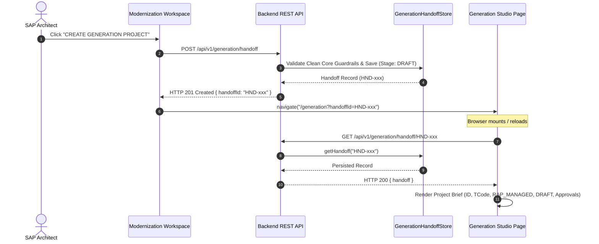

# FioriX Generation Studio Project Handoff Specification (MW-03)

## 1. Executive Summary

The **Generation Studio Project Handoff** establishes an authoritative, server-persisted architectural bridge between the Assessment Results engine and the Generation Studio (`/generation?handoffId=...`).

It guarantees that:
- Handoff records are **persisted authoritatively on the backend** (`backend/data/generationHandoffs.json`).
- Context **survives page refreshes** without reliance on ephemeral browser storage.
- The initial generation project lifecycle state is strictly **`DRAFT`**.
- Clean Core standard-first guardrails and Lead Enterprise Architect sign-offs are strictly verified before handoff creation.

---

## 2. Generation Handoff Data Model

```typescript
export interface GenerationHandoffRecord {
  handoffId: string;                     // e.g. "HND-1794320000-ABC"
  sourceAssessmentId: string;            // e.g. "ASM-S4-F53-001"
  tcode: string;                         // e.g. "F-53"
  transactionDescription: string;        // e.g. "Post Outgoing Payments"
  targetRelease: string;                 // e.g. "SAP S/4HANA 2023 Private Edition"
  systemId: string;                      // e.g. "S21"
  client: string;                        // e.g. "200"
  programName: string;                   // e.g. "SAPMF05A"
  packageName: string;                   // e.g. "FBAS"
  classification: string;                // e.g. "STANDARD"
  currentStage: 'DRAFT';                 // Initial generation stage
  proposedAppType: 'RAP_MANAGED';        // Recommended architecture
  approvalStatus: 'APPROVED' | 'PENDING_APPROVAL';
  leadArchitectApproval: {
    approved: boolean;
    approver: string;
    approverId: string;
    timestamp: string;
    justification: string;
  };
  cleanCoreJustification: string;
  businessRequirements: {
    process: string;
    scenario: string;
    requiredCapabilities: string[];
  };
  identifiedGaps: string[];
  architectureBaseline: {
    backendModel: 'RAP_MANAGED';
    cdsViewType: 'VIEW_ENTITY';
    odataVersion: 'ODATA_V4';
    uiPattern: 'FIORI_ELEMENTS_LIST_REPORT_OBJECT_PAGE';
    cleanCoreTier: 'TIER_2_CLOUD_DEVELOPER';
  };
  verifiedMetadata: {
    programName: string;
    screenNumber: string;
    packageName: string;
    softwareComponent: string;
  };
  createdAt: string;
  updatedAt: string;
  createdBy: string;
  creatorName: string;
}
```

---

## 3. Endpoints Specification

### 3.1 Create Generation Handoff
- **Method**: `POST`
- **Route**: `/api/v1/generation/handoff`
- **Body**: `Partial<GenerationHandoffRecord>`
- **Response**: `HTTP 201 Created`
```json
{
  "success": true,
  "statusCode": "CREATED",
  "handoff": {
    "handoffId": "HND-1794320000-A1B2",
    "sourceAssessmentId": "ASM-S4-F53-001",
    "tcode": "F-53",
    "currentStage": "DRAFT",
    "proposedAppType": "RAP_MANAGED",
    "approvalStatus": "APPROVED",
    "leadArchitectApproval": {
      "approved": true,
      "approver": "Lead SAP Enterprise Architect",
      "timestamp": "2026-11-10T20:30:00.000Z",
      "justification": "Proprietary payment engine reimplementation under Clean Core."
    },
    "createdAt": "2026-11-10T20:30:00.000Z"
  }
}
```

### 3.2 Retrieve Generation Handoff by ID
- **Method**: `GET`
- **Route**: `/api/v1/generation/handoff/:id`
- **Behavior**:
  - Resolves handoff record directly from backend file store.
  - If found: returns `HTTP 200` with full handoff details.
  - If missing: returns `HTTP 404 Not Found`.

### 3.3 List Generation Handoffs
- **Method**: `GET`
- **Route**: `/api/v1/generation/handoff?assessmentId=...&tcode=...`
- **Response**: `HTTP 200` with array of matching handoffs.

---

## 4. Generation Studio Page Resolution Lifecycle


