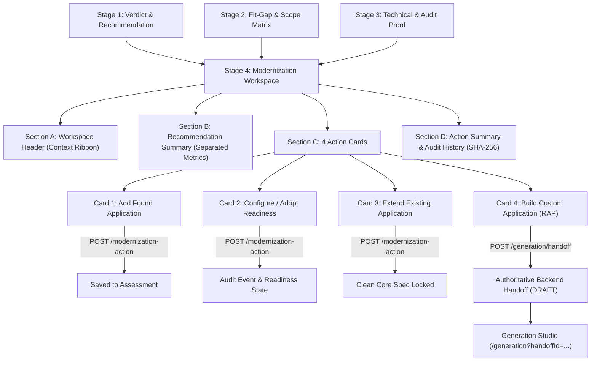

# Fiorify Modernization Workspace Specification (MW-01)

## 1. Overview & Purpose

The **Modernization Workspace** (Stage 4 of the Fiorify Assessment Results lifecycle) transforms static transaction assessment findings into an actionable, evidence-governed SAP decision workspace. It empowers SAP enterprise architects and functional leads to decide and commit the modernization strategy for any assessed SAP transaction:

1. **Card 1: ADD FOUND APPLICATION** — Save an officially matched standard SAP Fiori application.
2. **Card 2: CONFIGURE / ADOPT** — Prepare standard applications for implementation with a 9-item independent readiness checklist.
3. **Card 3: EXTEND EXISTING APPLICATION** — Formulate a Clean Core extensibility specification where standard apps exhibit verified functional gaps.
4. **Card 4: BUILD CUSTOM APPLICATION** — Initiate custom ABAP Cloud / RAP generation under strict Clean Core governance and Lead Architect sign-off.

---

## 2. Workspace User Experience Architecture

---

## 3. Section Details

### Section A — Workspace Header
- **Title**: `Modernization Workspace`
- **Subtitle**: `Choose the right modernization path based on the completed transaction assessment.`
- **Context Ribbon Fields**:
  - `Assessment ID`: Canonical identifier (e.g. `ASM-S4-F53-001`).
  - `Transaction Code`: Assessed SAP GUI transaction (e.g. `F-53`).
  - `Business Process`: Functional area (e.g. `Financial Accounting / Accounts Payable`).
  - `SAP System / Client`: Target landscape node (e.g. `S21 / Client 200`).
  - `Target Release`: Explicit release anchor (e.g. `SAP S/4HANA 2023 Private Edition`).
  - `Assessment Status`: Lifecycle stage (`RECOMMENDATION_COMPLETED`, `PENDING_REVIEW`, `APPROVED`).
  - `Recommended Modernization Outcome`: Canonical badge (`ADOPT`, `CONFIGURE`, `EXTEND`, `BUILD`, `INSUFFICIENT_EVIDENCE`, `PENDING_VERIFICATION`).

### Section B — Recommendation Summary & Verification Metrics
- **Recommended Path**: Canonical outcome with verified rationale.
- **Evidence Completeness KPI**: Percentage calculated across 5 independent evidence categories (Technical, DDIC, Gateway, ICF, Catalogue).
- **Recommendation Confidence KPI**: Distinct confidence percentage based on evidence stability and source provenance.
- **Rule**: Confidence and completeness are **strictly separated** and never averaged or conflated into a single percentage.
- **Outstanding Verifications**: Enumeration of remaining Basis/Security checks (e.g., service activation, role assignment, ICF activation).
- **Candidate Applications**: Number of evaluated candidates and primary target app.

### Section C — Four Modernization Options (Action Cards)

#### Card 1 — Add Found Application
- **Purpose**: Persist a selected standard Fiori app against the assessment.
- **Displayed Properties**: App ID, App Title, Application Type, UI Technology, Product Version, Functional Match, Release Compatibility, Official Source Provenance link.
- **Candidate Selector**: Allows switching between candidate apps discovered in the official catalogue.
- **Action**: `ADD FOUND` button triggering backend persistence.

#### Card 2 — Configure / Adopt Readiness Checklist
- **Purpose**: Prepare standard app for implementation by evaluating prerequisites without executing SAP changes.
- **9 Independent Checklist Items**:
  1. `productReleaseCompatibility` (Product release compatibility)
  2. `odataServices` (OData V2/V4 services registered)
  3. `serviceRegistration` (Service registered in `/IWFND/MAINT_SERVICE` with system alias `LOCAL`)
  4. `icfUi5Services` (ICF node active in `SICF`)
  5. `systemAlias` (System alias configured)
  6. `businessCatalogue` (Business catalogue mapped in `/UI2/FLPCM_CUST`)
  7. `pfcgBusinessRoles` (PFCG business role assigned in `PFCG`/`SU01`)
  8. `launchpadAvailability` (Launchpad spaces/pages availability)
  9. `userAuthorization` (User authorization verification in `SU53`)
- **Item Statuses**: Each item can independently be set to `VERIFIED`, `PENDING`, `BLOCKED`, `NOT_APPLICABLE`, or `NOT_VERIFIED`.
- **Action**: `RECORD ADOPTION READINESS` button appending an audit event.

#### Card 3 — Extend Existing Application
- **Purpose**: Plan a Clean Core extension where standard app has verified gaps.
- **Displayed Properties**: Target standard app ID/Title, Identified missing capabilities & functional gaps, Extension scope notes.
- **Extensibility Hierarchy**:
  - `Tier 1: Key User Extensibility` (Custom Fields & Logic app, UI adaptation).
  - `Tier 2: On-Stack Developer Extensibility` (ABAP Cloud, released BAdIs via ADT, RAP behavior extension).
  - `Tier 3: Side-by-Side SAP BTP Extensibility` (Decoupled CAP services via Cloud Connector).
- **Clean Core Rule**: Prohibits inventing unverified BAdIs; requires ADT discovery for released developer extension points.
- **Action**: `SAVE EXTENSION SPECIFICATION` button.

#### Card 4 — Build Custom Application
- **Purpose**: Commission a governed custom application project when no standard Fiori app exists or standard options are exhausted.
- **Displayed Properties**: Verified reason for custom build, evaluated standard candidates, functional gaps requiring custom code, technical DDIC evidence, target architecture baseline (RAP Managed, CDS View Entity v2, OData V4, Fiori Elements LR/OP).
- **Clean Core Standard-First Guardrail**:
  - If standard candidate exists, custom build is **restricted**.
  - Requires documented business justification and explicit Lead Enterprise Architect sign-off.
  - If evidence completeness < 50% or catalogue verification is incomplete, creation is disabled.
- **Action**: `CREATE GENERATION PROJECT` button creating an authoritative backend handoff record in stage `DRAFT` and navigating to Generation Studio.

### Section D — Action Summary & Audit History
- **Summary Grid**: Selected Path, Current State, Required Next Action, Assigned Reviewer.
- **Governance Audit Trail**: Chronological list of recorded modernization actions with author, timestamp, action type, and cryptographic hash chain integrity status.

---

## 4. Contextual Highlighting Rules

| Assessment Recommendation | Highlighted Card | Card State |
|:---|:---|:---|
| `ADOPT` | Card 1 & Card 2 | Recommended Badge, primary emphasis |
| `CONFIGURE` | Card 2 | Recommended Badge, primary emphasis |
| `EXTEND` | Card 3 | Recommended Badge, primary emphasis |
| `BUILD` | Card 4 | Recommended Badge, primary emphasis |
| `PENDING_VERIFICATION` | Warning Ribbon | Prompts for additional Basis/Catalogue verification |
| `INSUFFICIENT_EVIDENCE` | Warning Ribbon | Disables custom build, requires technical evidence |
