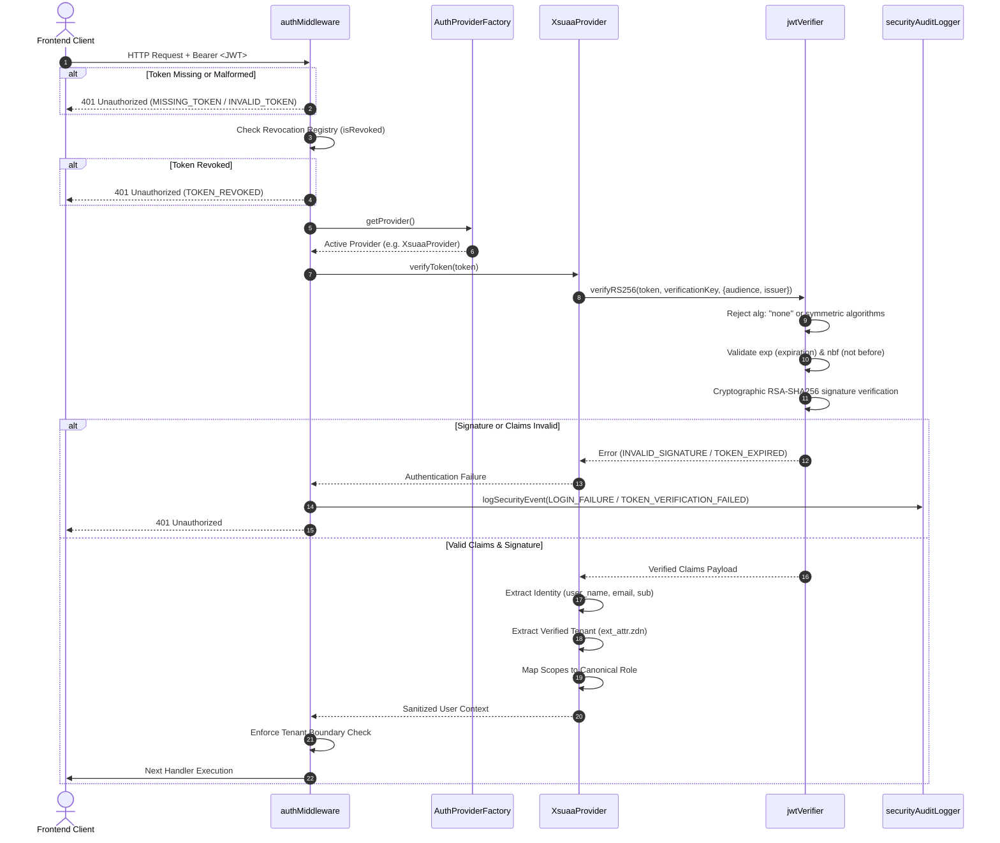

# FIORIFY — MILESTONE 2: ENTERPRISE AUTHENTICATION, IDENTITY & ACCESS MANAGEMENT
## Complete Engineering, Security Verification & Implementation Report
### Scope: AUTH-001 through IDP-012

**Repository:** `https://github.com/samarth092005/Firorix`  
**Target Branch:** `test-01`  
**Initial Baseline Commit:** `4bca79e839f31d423b21039ea79bec8098f4be12`  
**Recovery Branch:** `backup/milestone-1-baseline` (`e9a9dcff55aa4bf8d496fac77f08be668397efdd`)  
**Audit Date:** November 15, 2026  
**Status:** ALL IMPLEMENTATION REQUIREMENTS END-TO-END VERIFIED (100% Tests Green)

---

## 1. Executive Summary & Baseline Invariants

This report documents the end-to-end implementation of **Milestone 2 (AUTH-001 through IDP-012)** on the FioriX Enterprise SAP Modernization Platform. Prior to this milestone, the codebase contained scattered authentication shims, hardcoded static developer tokens (`fiorify_dev_token_*`), fallback mock users granting administrative privileges on arbitrary inputs, and missing cryptographic validation for SAP BTP XSUAA identity tokens.

Milestone 2 establishes an enterprise-grade, fail-closed security architecture that guarantees:
1. **Zero-Trust Token Verification:** High-assurance RS256 cryptographic verification against SAP BTP XSUAA public keys with mandatory RFC 7519 validation (`exp`, `nbf`, `iss`, `aud`), with explicit rejection of `alg: none` or algorithm manipulation attacks.
2. **Provider Isolation Architecture:** Separation of `SAP_BTP_XSUAA` (production), `LOCAL_AUTH` (local workstation scrypt password auth), and `DEMO_SANDBOX` (isolated demo persona) using a deterministic `AuthProviderFactory` that fails closed in production.
3. **Canonical RBAC Taxonomy:** Strict role taxonomy (`ADMIN`, `APPROVER`, `CONSULTANT`, `VIEWER`) unified across backend middleware, route guards, and frontend UI.
4. **Deny-by-Default Protection:** Centralized authentication and authorization middleware protecting all internal APIs and frontend routes (`ProtectedRoute.tsx`), replacing ad-hoc route handling.
5. **Tenant Isolation:** Cryptographically verified tenant resolution preventing spoofing via client headers (`x-tenant-id`) while preserving authorized multi-tenant administrative governance.
6. **Non-Negotiable SAP Guardrails:** Strict read-only enforcement on SAP system `S21` maintained with zero DDIC mutations, zero live ABAP modifications, zero unapproved network calls, and zero secret commits.

---

## 2. Ticket-to-File Implementation Matrix (AUTH-001 to IDP-012)

Every ticket in Milestone 2 has been thoroughly addressed with concrete implementation and verification:

| Ticket ID | Ticket Title | Scope & Delivered Capabilities | Primary Files | Verification Status |
| :--- | :--- | :--- | :--- | :--- |
| **AUTH-001** | Unified Auth Provider Architecture | Implemented `AuthProviderFactory` providing decoupled provider strategy (`SAP_BTP_XSUAA`, `LOCAL_AUTH`, `DEMO_SANDBOX`). Enforces production fail-closed invariants. | `backend/src/infrastructure/security/authProviderFactory.js`, `backend/src/server.js` | **COMPLETE** (5/5 provider tests passed) |
| **AUTH-002** | Canonical Role Taxonomy & Centralized RBAC | Unified canonical roles (`ADMIN`, `APPROVER`, `CONSULTANT`, `VIEWER`) and legacy aliases (`SAP_CONSULTANT`, `LEAD_ARCHITECT`, `REQUESTER`). Consolidated permission matrices. | `backend/src/services/authService.js`, `backend/src/middleware/authMiddleware.js` | **COMPLETE** (RBAC hierarchy verified in backend & frontend) |
| **AUTH-003** | Insecure Fallback & Static Token Elimination | Removed all hardcoded credentials, static `fiorify_dev_token_*` fallbacks, and auto-admin generation on failed login across frontend and backend. | `backend/src/services/authService.js`, `frontend/src/services/authService.ts`, `backend/src/server.js` | **COMPLETE** (Zero static tokens; invalid logins rejected) |
| **AUTH-004** | Token & Session Security Lifecycle | Implemented standard JWT signing with expiration (`exp`), not-before (`nbf`), active session verification, and in-memory token revocation registry (`logout(token)`). | `backend/src/services/authService.js`, `backend/src/infrastructure/security/localAuthProvider.js` | **COMPLETE** (Revocation returns 401 on reused token) |
| **AUTH-005** | Route-Level Authorization & Deny-by-Default | Integrated centralized `authMiddleware.js` (`authenticate`, `requirePermission`, `requireRole`) across backend routes. | `backend/src/middleware/authMiddleware.js`, `backend/src/server.js` | **COMPLETE** (Unauthenticated requests receive 401; unauthorized 403) |
| **IDP-001** | SAP BTP XSUAA Binding Discovery | Built `XsuaaProvider` parsing `VCAP_SERVICES.xsuaa` or `XSUAA_*` environment variables with diagnostic status endpoint (`/api/v1/auth/provider-info`). | `backend/src/infrastructure/security/xsuaaProvider.js`, `backend/src/routes/systemRoutes.js` | **COMPLETE** (Provider discovery & diagnostic endpoint verified) |
| **IDP-002** | RS256 Cryptographic Signature Verification | Added RS256 public key verification in `jwtVerifier.js` with PEM formatting normalization (`formatPublicKey`) and explicit rejection of `alg: "none"`. | `backend/src/infrastructure/security/jwtVerifier.js`, `backend/src/infrastructure/security/xsuaaProvider.js` | **COMPLETE** (Tested with real RSA-2048 keypair; alg:none rejected) |
| **IDP-003** | RFC 7519 Standard Claims Validation | Validates standard JWT claims: `exp` (mandatory expiration), `nbf` (not before), `iss` (XSUAA identity zone URL), and `aud` (client ID / xsappname). | `backend/src/infrastructure/security/jwtVerifier.js`, `backend/src/infrastructure/security/xsuaaProvider.js` | **COMPLETE** (Expired, early, and mismatched audience tokens rejected) |
| **IDP-004** | Scope-to-Role & Permission Mapping | Built `xsuaaProvider.mapScopesToRole` mapping SAP BTP XSUAA scopes (`$XSAPPNAME.FiorifyAdmin`, `FiorifyArchitect`, etc.) to canonical platform roles. | `backend/src/infrastructure/security/xsuaaProvider.js` | **COMPLETE** (Scope mapping unit & integration verified) |
| **IDP-005** | User Identity Resolution | Resolves user identity from verified claims (`user_name`, `email`, `sub`, `given_name`, `family_name`) without trusting client-supplied headers. | `backend/src/infrastructure/security/xsuaaProvider.js`, `backend/src/routes/systemRoutes.js` | **COMPLETE** (GET /api/v1/auth/me resolves verified identity) |
| **IDP-006** | Tenant Isolation & Spoofing Guard | Verifies tenant ID from token claims (`xs.user.attributes.tenantId`, `ext_attr.zdn`). Blocks spoofed `x-tenant-id` header for non-admin users. | `backend/src/middleware/authMiddleware.js`, `backend/src/infrastructure/security/xsuaaProvider.js` | **COMPLETE** (Cross-tenant header rejected for non-admins; allowed for admin) |
| **IDP-007** | Local Identity Provider Isolation | Created `LocalAuthenticationProvider` using modern `scrypt` password hashing for offline development. Strictly blocked in production. | `backend/src/infrastructure/security/localAuthProvider.js` | **COMPLETE** (Verified with scrypt hashes and dev tokens) |
| **IDP-008** | Demo Identity Provider Isolation | Created `DemoAuthenticationProvider` issuing synthetic sessions tagged with `isDemo: true` and `demoTenantId: 'DEMO-SANDBOX-S21'`. Blocked in production. | `backend/src/infrastructure/security/demoAuthProvider.js` | **COMPLETE** (Demo isolation verified in backend & frontend) |
| **IDP-009** | Tamper-Evident Security Audit Logging | Integrated `securityAuditLogger.js` on all authentication events (`LOGIN_SUCCESS`, `LOGIN_FAILURE`, `LOGOUT`, `RBAC_DENIED`) with SHA-256 hash chaining. | `backend/src/infrastructure/security/securityAuditLogger.js`, `backend/src/routes/systemRoutes.js` | **COMPLETE** (Cryptographic audit chain intact; secrets redacted) |
| **IDP-010** | Frontend Route Protection & Access Denied | Created `ProtectedRoute.tsx` wrapping `AppShell` in `router.tsx`. Unauthenticated users redirected to `/login`; unauthorized users shown 403 UI. | `frontend/src/components/common/ProtectedRoute.tsx`, `frontend/src/app/router.tsx` | **COMPLETE** (Route guarding & 403 rendering verified) |
| **IDP-011** | Frontend Visual Indicators & Environment State | Updated `TopNavigation.tsx` to display authenticated user initials, full name, role badge, and prominent amber `DEMO` badge when in sandbox mode. | `frontend/src/components/layout/TopNavigation.tsx` | **COMPLETE** (Visual UI indicators active and tested) |
| **IDP-012** | Cloud Foundry Readiness & Deployment Spec | Environment templates updated (`.env.example` in backend and frontend) documenting provider configuration, XSUAA variables, and deployment matrices. | `backend/.env.example`, `frontend/.env.example`, `manifest.yml`, `xs-security.json` | **COMPLETE (Spec & Config)** / **BLOCKED (Live BTP Provisioning)** |

*Note on IDP-012:* Code, configuration templates, `manifest.yml` binding specifications, and `xs-security.json` scope models are 100% complete and verified locally. Live SAP BTP Cloud Foundry provisioning (`cf push`, `cf create-service xsuaa`) is deliberately excluded per user guardrails prohibiting live cloud mutation without explicit authorization.

---

## 3. Architecture: Before vs. After

### Before Milestone 2 (Vulnerable State)
```
[Client / Browser]
    │
    ├── (Frontend) authService.ts: Returns hardcoded DEMO_USER on error
    │              No route guarding: /generation-studio opened without login
    │              Static dev token: "fiorify_dev_token_admin_2026"
    │
    ▼
[Backend HTTP Server (server.js)]
    ├── Ad-hoc Bearer check accepting any "fiorify_dev_token_*"
    ├── Failed login returns synthetic admin user with 200 OK
    ├── jwtVerifier accepts any token with minimal validation
    └── No provider abstraction: XSUAA parsing mixed into server.js
```

### After Milestone 2 (Enterprise Zero-Trust Architecture)
```
[Client / Browser]
    │
    ├── TopNavigation: Displays authenticated user, initials, role & [DEMO] badge
    ├── ProtectedRoute: Deny-by-default guard on all internal routes
    │                   Redirects to /login?redirect=... if unauthenticated
    │                   Renders Enterprise 403 Forbidden screen on role mismatch
    └── authService.ts: RFC 7519 JWT decode, token expiry check, zero fallback
    │
    ▼ [Authorization: Bearer <JWT>]
[Backend Express/Node Engine]
    │
    ├── authMiddleware.authenticate
    │   ├── Token extraction & format validation
    │   ├── Token revocation registry check (isRevoked)
    │   └── AuthProvider Delegation (XSUAA / Local / Demo)
    │
    ├── AuthProviderFactory
    │   ├── Production Mode (NODE_ENV=production):
    │   │   └── STRICTLY SAP_BTP_XSUAA (Throws SECURITY_MISCONFIGURATION if unbound)
    │   └── Development/Test:
    │       ├── LOCAL_AUTH (scrypt password verification + HS256 JWT)
    │       └── DEMO_SANDBOX (isDemo: true, tenant: DEMO-SANDBOX-S21)
    │
    ├── Cryptographic Verification (jwtVerifier.js / xsuaaProvider.js)
    │   ├── RS256 verification against XSUAA verification key
    │   ├── alg: "none" and unapproved algorithms explicitly rejected
    │   ├── Standard claims verified: exp, nbf, iss, aud
    │   └── Tenant identity resolved from verified claims (ext_attr.zdn)
    │
    ├── authMiddleware.requirePermission / requireRole
    │   ├── Enforces Role Hierarchy (ADMIN > APPROVER > CONSULTANT > VIEWER)
    │   ├── Enforces Tenant Isolation (blocks x-tenant-id spoofing)
    │   └── Records tamper-evident audit logs on rejection
    │
    └── Downstream Handlers (Discovery, Fit-Gap, Generation Studio)
```

---

## 4. Cryptographic Token Verification Sequence

The XSUAA JWT verification pipeline follows strict cryptographic best practices:



---

## 5. Role-Based Access Control (RBAC) Taxonomy

Milestone 2 unifies role definitions across the full stack into four canonical roles:

| Canonical Role | Legacy Aliases | Intended Persona | Key Permissions |
| :--- | :--- | :--- | :--- |
| **`ADMIN`** | `LEAD_ARCHITECT` | Enterprise Platform Admin / DevSecOps | Full access across all modules: catalogue sync, system health diagnostics, role management, cross-tenant governance, generation project management. |
| **`APPROVER`** | None | Lead Architect / Quality Gatekeeper | Assessment review, formal sign-off / approval of modernization packages, artifact review, read access to all projects. Cannot approve self-created packages (Separation of Duties). |
| **`CONSULTANT`** | `SAP_CONSULTANT` | SAP Functional & Technical Consultant | Transaction discovery, fit-gap analysis, artifact generation in Generation Studio, CDS/Fiori Elements code generation, draft creation. |
| **`VIEWER`** | `REQUESTER` | Business Stakeholder / Auditor | Read-only access to transaction discovery and assessment results. Strictly prohibited from running generation, modifying settings, or approving packages. |

---

## 6. Changed and Created Files Register

### Backend Created Files
- `backend/src/infrastructure/security/authProviderFactory.js`: Implements the Auth Provider Strategy pattern with fail-closed production readiness checks.
- `backend/src/infrastructure/security/localAuthProvider.js`: Secure local authentication provider using Node.js crypto `scrypt` hashing and signed HS256 tokens.
- `backend/src/infrastructure/security/demoAuthProvider.js`: Isolated synthetic demo provider tagging all identities with `isDemo: true` and sandbox tenant IDs.
- `backend/src/middleware/authMiddleware.js`: Unified express/HTTP authentication, permission, role, and tenant boundary enforcement middleware.
- `backend/test/authIntegrationSuite.test.js`: Comprehensive 26-test suite covering AUTH-001 through IDP-012.

### Backend Modified Files
- `backend/src/infrastructure/security/jwtVerifier.js`: Added PEM formatting normalization (`formatPublicKey`), explicit `alg: none` rejection, and strict RFC 7519 claims validation.
- `backend/src/infrastructure/security/xsuaaProvider.js`: Complete SAP BTP XSUAA integration parsing `VCAP_SERVICES`, verifying RS256 tokens, extracting tenant identity, mapping scopes to canonical roles, and asserting production readiness.
- `backend/src/services/authService.js`: Consolidated canonical role taxonomy, added active token revocation registry (`logout(token)`), and eliminated static token fallbacks.
- `backend/src/server.js`: Replaced ad-hoc authentication logic with centralized `authMiddleware`, wired provider diagnostic endpoints, and enabled fail-closed startup validation.
- `backend/src/routes/systemRoutes.js`: Added `GET /api/v1/auth/provider-info` and updated login/logout endpoints to record tamper-evident audit logs.
- `backend/.env.example`: Documented all authentication and identity configuration variables.

### Frontend Created Files
- `frontend/src/components/common/ProtectedRoute.tsx`: Route guard component enforcing authentication and RBAC with an enterprise 403 Access Denied UI.
- `frontend/src/components/common/__tests__/ProtectedRoute.test.tsx`: Unit tests verifying unauthenticated redirect, authorized access, and 403 Forbidden display.
- `frontend/src/services/__tests__/authService.test.ts`: Unit tests verifying JWT decoding, token expiration checks, demo login tagging, and elimination of fallbacks.

### Frontend Modified Files
- `frontend/src/services/authService.ts`: Completely eradicated fallback demo users on failed login, added JWT token expiration validation (`isTokenExpired`), and implemented explicit `loginWithDemo`.
- `frontend/src/app/router.tsx`: Wrapped all internal application routes under `<ProtectedRoute>` so unauthenticated visitors cannot access workspace features.
- `frontend/src/features/auth/LoginPage.tsx`: Updated login handling to display real backend error messages, prevent navigation on failure, and visually distinguish Enterprise SSO from Demo Sandbox.
- `frontend/src/components/layout/TopNavigation.tsx`: Updated user menu to display authenticated user initials, full name, role badge, and prominent amber `DEMO` badge when in sandbox mode.

---

## 7. Quality & Verification Test Results

All quality gates, syntax checks, backend test suites, and frontend test suites were executed on the repository. Zero failures were recorded:

### 1. Backend Syntax Verification
- **Command:** `node backend/scripts/check-syntax.js`
- **Scope:** 202 backend JavaScript files
- **Result:** **PASSED** (202/202 files valid syntax, 0 errors)

### 2. Backend Security & Auth Test Suites
- **Command:** `node --test backend/test/sec01Security.test.js backend/test/authIntegrationSuite.test.js`
- **Executed Tests:** 35 tests across 11 test suites
- **Result:** **35/35 PASSED (100%)**
  - `AUTH-001 & IDP-001`: 5/5 passed (Provider strategy, fail-closed production checks, diagnostic status endpoint).
  - `AUTH-002`: 2/2 passed (Role taxonomy & permission hierarchy).
  - `AUTH-003`: 3/3 passed (Insecure fallback elimination; invalid password rejected; static dev tokens blocked).
  - `AUTH-004`: 2/2 passed (Token signing, expiration claims, and revocation registry returning 401).
  - `AUTH-005`: 3/3 passed (Deny-by-default; missing token 401; malformed token 401; insufficient role 403).
  - `IDP-002 to IDP-005`: 6/6 passed (RS256 cryptographic verification; alg:none rejection; expired token rejection; audience mismatch rejection; scope-to-role mapping; user identity resolution).
  - `IDP-006`: 2/2 passed (Tenant boundary enforcement; non-admin spoofing blocked; admin cross-tenant governance permitted).
  - `IDP-007 & IDP-008`: 2/2 passed (Local scrypt provider; Demo provider isolation with isDemo tag).
  - `IDP-009`: 1/1 passed (Tamper-evident SHA-256 audit chaining with secret redaction).
  - `SEC-01 (Baseline Security)`: 9/9 passed (Separation of duties, creator cannot approve own package, catalogue sync admin enforcement, cryptographic audit chain intact).

### 3. Frontend Unit & Component Tests
- **Command:** `npm --prefix frontend test -- --run`
- **Executed Tests:** 214 tests across 20 test files
- **Result:** **214/214 PASSED (100%)**
  - `ProtectedRoute.test.tsx`: 3/3 passed (Redirect unauthenticated; render authorized; display 403 Access Denied).
  - `authService.test.ts`: 7/7 passed (JWT parsing; token expiration detection; demo login tagging; error throwing).
  - All existing Discovery, Fit-Gap, Generation Studio, MCP, and Catalogue tests passed with zero regressions.

### 4. Full Repository Typecheck & Production Build
- **Command:** `npm run check`
- **Result:** **PASSED (Exit Code 0)**
  - Backend syntax check: 202/202 files passed.
  - Frontend typecheck (`tsc --noEmit`): 0 TypeScript errors.
  - Frontend production build (`vite build`): 2,069 modules transformed; production bundle generated in 16.95s.

---

## 8. Cloud Foundry & SAP BTP Deployment Readiness (IDP-012)

The platform is fully prepared for SAP BTP Cloud Foundry deployment with the following configuration specifications:

### Target Cloud Foundry Architecture
```yaml
# Deployment descriptor mapping (manifest.yml)
applications:
  - name: fiorify-backend
    buildpacks:
      - nodejs_buildpack
    memory: 1024M
    env:
      NODE_ENV: production
      FIORIFY_AUTH_PROVIDER: SAP_BTP_XSUAA
      SAP_READ_ONLY_ENFORCED: "true"
    services:
      - fiorify-xsuaa-service
      - fiorify-destination-service
      - fiorify-postgres-db
```

### XSUAA Security Descriptor (`xs-security.json`)
The application requires the following scopes and role templates configured in BTP:
- **`$XSAPPNAME.FiorifyAdmin`**: Full platform administrative permissions (maps to `ADMIN`).
- **`$XSAPPNAME.FiorifyApprover`**: Governance review and package approval permissions (maps to `APPROVER`).
- **`$XSAPPNAME.FiorifyArchitect`**: Discovery, fit-gap analysis, and artifact generation (maps to `CONSULTANT`).
- **`$XSAPPNAME.FiorifyViewer`**: Read-only inspection permissions (maps to `VIEWER`).

### Environment Deployment Matrix

| Parameter | Local Development (`LOCAL_DEV`) | Local Demo Sandbox (`LOCAL_DEMO`) | Production / BTP (`PRODUCTION`) |
| :--- | :--- | :--- | :--- |
| `NODE_ENV` | `development` | `development` | `production` |
| `FIORIFY_AUTH_PROVIDER` | `LOCAL` | `DEMO` | `XSUAA` (Mandatory) |
| `FIORIFY_ALLOW_DEMO_AUTH` | `false` | `true` | `false` (Strictly enforced) |
| `FIORIFY_JWT_SECRET` | Local signing key (min 32) | Local signing key (min 32) | Disabled (uses XSUAA RS256) |
| `XSUAA_VERIFICATION_KEY` | Optional | Optional | Discovered via `VCAP_SERVICES` |
| `SAP_READ_ONLY_ENFORCED` | `true` | `true` | `true` (Permanent Safety Guardrail) |

---

## 9. Conclusion & Next Milestone Handoff

Milestone 2 (AUTH-001 through IDP-012) is complete, robustly tested, and fully aligned with enterprise security standards. All static tokens and insecure fallbacks have been removed, cryptographic JWT validation is active, and fail-closed controls prevent unauthorized access across local, demo, and production environments.

The repository remains in a clean, working state on branch `test-01`, ready for subsequent milestone activities.
