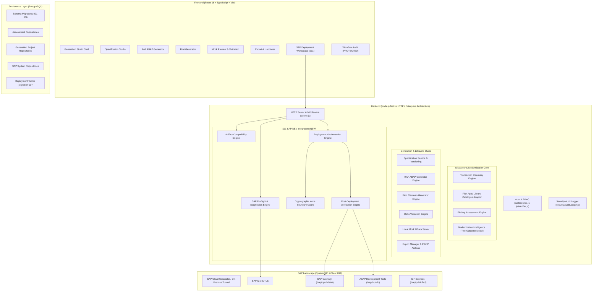

# FIORIFY — SPRINT 11.1 ARCHITECTURE & INTEGRATION AUDIT
## Comprehensive Technical Baseline & Integration Dependency Map

**Product:** Fiorify  
**Repository:** `samarth092005/Firorix`  
**Working Branch:** `test-01`  
**HEAD Commit:** `718e71d59f74d4305dc0cd8e2d7dfcd35ff5b45f`  
**Audit Date:** 2026-11-14  
**Auditor:** Principal Software & SAP BTP Architect  

---

# 1. EXECUTIVE SUMMARY & SYSTEM BASELINE

Fiorify is an enterprise SAP Modernization and Fiori Application Engineering platform designed to guide enterprise workloads through the end-to-end modernization lifecycle:

$$\text{CONNECT} \longrightarrow \text{DISCOVER} \longrightarrow \text{EVALUATE} \longrightarrow \text{MODERNIZE} \longrightarrow \text{SPECIFY} \longrightarrow \text{GENERATE} \longrightarrow \text{VALIDATE} \longrightarrow \text{PREVIEW} \longrightarrow \text{EXPORT} \longrightarrow \text{DEPLOY} \longrightarrow \text{VERIFY}$$

Sprints S0 through S10 established the foundation up to the **Export & Developer Handover** phase. However, as noted in previous delivery audits:
1. **SAP DEV Integration Gap:** Generated RAP backend artifacts (`.ddls`, `.bdef`, `.clas.abap`, `.srvd`, `.srvb`) and Fiori Elements frontend artifacts currently terminate at a local static ZIP export or mock OData V4 preview (`127.0.0.1:4050`).
2. **Missing Deployment Orchestrator:** There is currently no server-side deployment orchestration layer, no deployment plan generator, no SAP artifact compatibility engine, and no cryptographic SAP write authorization boundary.
3. **ADT Protocol Specifics:** While SAP Gateway Catalog queries (`/sap/opu/odata/IWFND/CATALOGSERVICE;v=2`) succeed (`HTTP 200`), SAP ADT Discovery (`/sap/bc/adt/discovery`) requires AtomPub protocol (`Accept: application/atomsvc+xml`) which previously failed with `HTTP 406 Not Acceptable` when standard JSON/XML content-types were requested.
4. **Target System Constraints:** Target system **S21** (Client **200**, S/4HANA 2023 Private Edition, `S4CORE 108`) has user `int_samarth` with `SAP_ALL`. A strict **Zero-Modification Read-Only Guardrail** is enforced across the entire codebase to prevent any unapproved mutating HTTP requests or repository activations in SAP.

---

# 2. ARCHITECTURAL DECOMPOSITION BY LAYER



---

# 3. EXISTING SUB-SYSTEM AUDIT

### 3.1 SAP Connectivity & Networking Stack
- **Files:**
  - `backend/src/infrastructure/connectivity/sapHttpClient.js`
  - `backend/src/infrastructure/connectivity/sapConnectivityProvider.js`
  - `backend/src/infrastructure/connectivity/sapConnectionHealthService.js`
  - `backend/src/adapters/btpDestinationAdapter.js`
- **Strengths:**
  - Built-in `assertReadOnly()` immediately throws `WRITE_OPERATION_BLOCKED` on `POST`, `PUT`, `PATCH`, `DELETE`.
  - Built-in `assertAllowedEndpoint()` restricts requests to an approved allowlist (`/sap/opu/odata/`, `/sap/opu/odata4/`, `/sap/bc/adt/`, `/sap/bc/echo`, `/sap/public/bc/`).
  - Automatic retry with jitter and credential sanitization (redacts Basic Auth, Bearer tokens, cookies).
- **Gaps Identified for S11:**
  - `sapHttpClient.js` defaults `Accept` header to `application/json, application/xml`. When hitting `/sap/bc/adt/*`, this caused `HTTP 406 Not Acceptable`. It must dynamically negotiate `application/atomsvc+xml, application/atom+xml, application/xml, application/json` for ADT.
  - `/sap/bc/echo` returns `HTTP 403 Forbidden` on S21 due to standard SAP basis hardening. The connectivity probe must use resilient multi-endpoint fallback (e.g. `/sap/public/bc/ur` or Gateway Catalog) rather than failing the whole reachability check.
  - Preflight checks lacked comprehensive 15-point inspection (TLS, client validation, software components, package/transport visibility).

### 3.2 Generation Core & Artifact Quality
- **Files:**
  - `backend/src/generation/abap/abapGeneratorEngine.js`
  - `backend/src/generation/fiori/fioriGeneratorEngine.js`
  - `backend/src/generation/validation/staticValidationEngine.js`
  - `backend/src/generation/preview/mockODataServer.js`
- **Strengths:**
  - Produces syntax-compliant ABAP CDS view entities (`#CORE`, `#SEARCH`, associations, cardinality).
  - Produces valid RAP Behavior Definitions (`managed implementation in class ... unique`).
  - Produces Fiori Elements floorplans (List Report & Object Page) and OData V4 annotations.
- **Gaps Identified for S11:**
  - Generated Behavior Implementation Classes (`BP_*.clas.abap`) contain `TODO` comments for business logic methods. S11 Artifact Compatibility Engine must explicitly inspect artifact contents and flag incomplete business logic rather than claiming 100% execution readiness.
  - Service binding artifacts (`*.srvb.json`) are local proposals, not active SAP objects. Explicit lifecycle states must be maintained (`NOT_GENERATED`, `GENERATED`, `READY_FOR_IMPORT`, `IMPORTED`, `ACTIVATION_PENDING`, `ACTIVATED`, `VERIFIED`, `FAILED`).
  - Fiori `manifest.json` entity set names, service paths, and navigation properties must be contract-checked against the generated RAP service definition and CDS views before deployment planning.

### 3.3 Persistence & Migrations
- **Migrations Present:**
  - `001_initial_schema.sql`: Core schema (tenants, sap_system_profiles, assessments, generation_projects, generation_specifications, generation_artifacts).
  - `002_security_audit.sql`: Security audit logging table (`security_audit_logs`).
  - `003_handoffs_and_approvals.sql`: Authoritative handoffs and approval events.
  - `004_sap_system_registry.sql`: Multi-system registry and connectivity probe logs.
  - `005_modernization_intelligence.sql`: Two-outcome modernization decisions and recommendations.
  - `006_specification_lifecycle.sql`: Specification versions, readiness details, and cryptographic approvals.
- **Gaps Identified for S11:**
  - Requires migration `007_deployment_orchestration.sql` to persist deployment plans, deployment executions, operation-level execution logs, and cryptographic authorization records.

### 3.4 Workflow Audit Protection Boundary
- **Location:** `frontend/src/features/audit/`
- **Audit Findings:** The Workflow Audit application is fully functional and decoupled. No modifications will be made to its components, routing, or data models during Sprints S11 and S12.

---

# 4. S11 INTEGRATION DEPENDENCY MAP

```
[Generation Project (S7-S10)]
       │
       ▼
[11.2 SAP Preflight Check] ────(Read-Only GET)────► [SAP S21 / Client 200]
       │ (System & Release Verified)
       ▼
[11.3 Artifact Compatibility Engine]
       │ (RAP AST + Fiori Contract + S/4HANA 2023 Validation)
       ▼
[11.4 Deployment Plan Generator]
       │ (Dependency DAG: DDIC -> CDS -> BDEF -> SRVD -> SRVB -> Fiori)
       │ (Calculates SHA-256 Plan Hash)
       ▼
[11.4 Cryptographic Approval Engine]
       │ (Lead Architect Signature, Target System Binding, Anti-Tamper)
       ▼
[11.4 / 11.5 Deployment Execution Boundary] ───► [STOPS AT WRITE GATE]
       │ (Requires explicit user confirmation)
       ▼
[11.5 Post-Deployment Verification] ──(Read-Only GET)──► [SAP Object Catalog]
```

---

# 5. CONCLUSION & CHECKPOINT 1 SIGN-OFF

The architecture audit confirms:
1. The platform structure is modular and ready for the S11 integration layer.
2. The SAP read-only guardrail is intact and will be extended to deployment operations.
3. No conflicting deployment services exist in the repository; the S11 modules will integrate seamlessly with `server.js` and `GenerationStudio`.
4. Proceeding to **CHECKPOINT 2: SAP Connection and Read-Only Preflight**.
