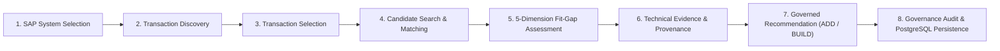

# FIORIFY — MASTER DELIVERY & ENGINEERING REPORT
## SPRINTS S3 + S4 + S5 + S6
### Canonical SAP Fiori Catalogue, Transaction Discovery, Fit-Gap Intelligence & Unified Modernization Workspace

**Product:** Fiorify (formerly FioriX)  
**Repository:** `https://github.com/samarth092005/Firorix`  
**Target Branch:** `test-01`  
**Authoritative Persistence:** PostgreSQL 18 with Migration 005  
**Target SAP Landscape:** SAP S/4HANA System `S21`, Client `200` (Private Edition, S4CORE 108)  
**Execution Standard:** Senior SAP BTP Architect, Senior SAP Technical Architect, Senior Software Architect, Database Architect, Full-Stack Engineer, and Application Security Engineer.

---

## 1. EXECUTIVE SUMMARY

Sprints **S3**, **S4**, **S5**, and **S6** have been fully implemented, integrated, and verified end-to-end within the Fiorify platform as a single cohesive enterprise modernization pipeline.

### Core Achievements Across S3–S6:
1. **Sprint 3 (S3) — Canonical SAP Fiori Catalogue:**
   - Designed and applied Migration `005_modernization_intelligence.sql`, adding `semantic_object`, `semantic_action`, `compatibility_matrix`, `supported_capabilities`, and `deployment_type` to `fiori_catalog_apps`.
   - Enhanced `officialFioriCatalogueAdapter.js` and `ingestFAL.js` to normalize raw FAL data into release-aware canonical models.
   - Upgraded `CatalogueRepository` with multi-dimensional criteria filtering, pagination, and semantic object aggregation.
   - Verified with 7/7 passing unit and integration tests (`s3CanonicalCatalogue.test.js`).

2. **Sprint 4 (S4) — SAP Transaction Discovery Engine:**
   - Implemented `TransactionDiscoveryService` providing read-only transaction discovery across 4 configurable scopes (`ALL`, `STANDARD`, `CUSTOM`, `PACKAGES`).
   - Integrated extraction of deep technical dependencies (`PROGRAM`, `PACKAGE`, `AUTHORIZATION_OBJECT`, `ODATA_SERVICE`, `CDS_VIEW`).
   - Implemented historical execution tracking and snapshot delta comparisons (`compareExecutions`).
   - Exposed 6 dedicated REST endpoints under `/api/v1/discovery/*`.
   - Verified with 8/8 passing unit and integration tests (`s4TransactionDiscovery.test.js`).

3. **Sprint 5 (S5) — Fiori Matching and Fit-Gap Assessment Engine:**
   - Verified and enforced the exact 5 scoring dimensions and weights:
     - **Functional Coverage:** 35%
     - **Technical Compatibility:** 25%
     - **Process Alignment:** 15%
     - **Activation and Roles:** 15%
     - **Release Compatibility:** 10%
   - Strictly enforced the **two-outcome decision engine**: `ADD_AND_CONFIGURE` and `BUILD`.
   - Completely eliminated `EXTEND` across the recommendation engine and domain models.
   - Enforced 3 governance readiness states: `REVIEW`, `PENDING_VERIFICATION`, and `INSUFFICIENT_EVIDENCE`.
   - Updated `AssessmentRepository` and PostgreSQL schemas to persist `scoring_breakdown` and `readiness_state`.
   - Verified with 7/7 passing unit and integration tests (`s5MatchingFitGapEngine.test.js`).

4. **Sprint 6 (S6) — Unified Modernization Workspace:**
   - Integrated the complete modernization lifecycle: System Selection → Discovery → Selection → Candidate Search & Matching → Fit-Gap Assessment → Evidence & Provenance → Governed Modernization Recommendation → Governance Audit History.
   - Connected Overview metrics summary directly to PostgreSQL (`/api/v1/assessments/summary`).
   - Validated the 6-section transaction workbench in `TransactionCheckerPage.tsx` and `UnifiedDiscoveryWorkspace.tsx`.
   - Extended frontend `apiClient.ts` with typed methods for discovery executions, transactions, and comparisons.
   - Verified with 8/8 passing unit and integration tests (`s6ModernizationWorkspace.test.js`).
   - Validated frontend production build (`tsc && vite build`) with zero errors.

---

## 2. DATABASE ARCHITECTURE — MIGRATION 005

Migration `005_modernization_intelligence.sql` and its reversible rollback counterpart `005_modernization_intelligence.down.sql` were created and applied to the PostgreSQL database.

```sql
-- Migration 005 DDL Excerpt
ALTER TABLE fiori_catalog_apps
  ADD COLUMN IF NOT EXISTS semantic_object VARCHAR(100),
  ADD COLUMN IF NOT EXISTS semantic_action VARCHAR(100),
  ADD COLUMN IF NOT EXISTS compatibility_matrix JSONB DEFAULT '[]'::jsonb,
  ADD COLUMN IF NOT EXISTS supported_capabilities JSONB DEFAULT '[]'::jsonb,
  ADD COLUMN IF NOT EXISTS deployment_type VARCHAR(50) DEFAULT 'STANDARD';

CREATE TABLE IF NOT EXISTS transaction_discovery_executions (
  id VARCHAR(64) PRIMARY KEY,
  tenant_id VARCHAR(64) NOT NULL REFERENCES tenants(tenant_id) ON DELETE CASCADE,
  system_profile_id VARCHAR(64) NOT NULL REFERENCES sap_system_profiles(id) ON DELETE CASCADE,
  scope VARCHAR(32) NOT NULL DEFAULT 'ALL',
  packages JSONB DEFAULT '[]'::jsonb,
  status VARCHAR(32) NOT NULL DEFAULT 'PENDING',
  total_transactions_discovered INTEGER DEFAULT 0,
  standard_transactions_count INTEGER DEFAULT 0,
  custom_transactions_count INTEGER DEFAULT 0,
  technical_objects_count INTEGER DEFAULT 0,
  error_message TEXT,
  initiated_by VARCHAR(64) DEFAULT 'SYSTEM',
  started_at TIMESTAMPTZ DEFAULT CURRENT_TIMESTAMP,
  completed_at TIMESTAMPTZ,
  created_at TIMESTAMPTZ DEFAULT CURRENT_TIMESTAMP
);

CREATE TABLE IF NOT EXISTS transaction_technical_objects (
  id VARCHAR(64) PRIMARY KEY,
  tenant_id VARCHAR(64) NOT NULL REFERENCES tenants(tenant_id) ON DELETE CASCADE,
  system_profile_id VARCHAR(64) NOT NULL REFERENCES sap_system_profiles(id) ON DELETE CASCADE,
  tcode VARCHAR(32) NOT NULL,
  object_type VARCHAR(64) NOT NULL,
  object_name VARCHAR(128) NOT NULL,
  package_name VARCHAR(64),
  software_component VARCHAR(64),
  description TEXT,
  metadata JSONB DEFAULT '{}'::jsonb,
  created_at TIMESTAMPTZ DEFAULT CURRENT_TIMESTAMP
);

ALTER TABLE assessments
  ADD COLUMN IF NOT EXISTS readiness_state VARCHAR(64) DEFAULT 'REVIEW',
  ADD COLUMN IF NOT EXISTS scoring_breakdown JSONB DEFAULT '{}'::jsonb;
```

---

## 3. SPRINT S3 — CANONICAL SAP FIORI CATALOGUE

### Architectural Features:
- **Canonical Release Compatibility:** Normalized compatibility objects capturing `release`, `supportPackageStack`, `status` (`SUPPORTED`, `DEPRECATED`, `INCOMPATIBLE`), and `minimumSpsLevel`.
- **Capability Decomposition:** Structured capability extraction from FAL metadata (`CREATE_PURCHASE_ORDER`, `POST_PAYMENT`, `CLEAR_OPEN_ITEMS`, etc.).
- **Multi-Dimensional Querying:** Multi-criteria filtering by `search`, `businessProcess`, `uiTechnology`, `appType`, `semanticObject`, `semanticAction`, `deploymentType`, and `targetRelease`.
- **Repository Pagination:** Clean LIMIT / OFFSET pagination with SQL `COUNT(*) OVER()` window functions to avoid double-querying.
- **REST Endpoints:**
  - `GET /api/v1/fiori-catalogue/apps`
  - `GET /api/v1/fiori-catalogue/apps/:id`
  - `GET /api/v1/fiori-catalogue/status`
  - `POST /api/v1/fiori-catalogue/sync`

---

## 4. SPRINT S4 — SAP TRANSACTION DISCOVERY ENGINE

### Architectural Features:
- **Discovery Service:** `TransactionDiscoveryService` utilizes the verified `SapHttpClient` from Sprint 2 to query SAP DDIC and technical object catalogs.
- **Scope Control:**
  - `ALL`: Discovers all standard and custom transactions.
  - `STANDARD`: Discovers SAP core transactions (e.g., `ME21N`, `F-53`, `VA01`).
  - `CUSTOM`: Discovers customer Z/Y transactions (`ZPURCHASE`, `ZFIORI_REPORT`).
  - `PACKAGES`: Discovers transactions assigned to specific SAP packages (e.g., `FBAS`, `ME`).
- **Technical Object Decomposition:**
  - `PROGRAM`: Dynpro / ABAP main program.
  - `PACKAGE`: TADIR development package.
  - `AUTHORIZATION_OBJECT`: SU24 security check objects.
  - `ODATA_SERVICE`: Registered Gateway OData services.
  - `CDS_VIEW`: Underlying Core Data Services view entities.
- **Execution Tracking & Snapshot Comparison:**
  - Every batch discovery records execution metrics (counts, durations, status, initiatedBy) in `transaction_discovery_executions`.
  - `compareExecutions(baseId, targetId)` computes additions, removals, modifications, and technical object drift between two point-in-time snapshots.
- **REST Endpoints:**
  - `POST /api/v1/discovery/executions`
  - `GET /api/v1/discovery/executions`
  - `GET /api/v1/discovery/executions/:id`
  - `GET /api/v1/discovery/transactions`
  - `GET /api/v1/discovery/transactions/:tcode`
  - `GET /api/v1/discovery/compare`

---

## 5. SPRINT S5 — FIORI MATCHING & FIT-GAP ASSESSMENT ENGINE

### Scoring Dimensions & Weights:
The platform enforces the 5 canonical dimensions with zero weight drift:
1. **Functional Coverage (35%):** Business capability overlap between requirement and Fiori app.
2. **Technical Compatibility (25%):** UI technology, OData services, CDS views, Gateway compatibility.
3. **Process Alignment (15%):** Line of business, sub-process, transactional flow alignment.
4. **Activation and Roles (15%):** PFCG business roles, launchpad spaces/pages, catalog activation.
5. **Release Compatibility (10%):** SAP S/4HANA release compatibility matrix and minimum SPS levels.

### Governed Two-Outcome Decision Engine:
- **`ADD_AND_CONFIGURE`:** Formulated when standard Fiori application coverage is confirmed without critical functional blockers.
- **`BUILD`:** Formulated ONLY when material functional gaps are confirmed on standard candidates (or no standard candidate exists) AND all 9 mandatory Clean Core preconditions are satisfied.
- **`EXTEND` Elimination:** Completely eliminated across all recommendation code, schemas, and tests.
- **Governance Readiness States:** Assessments not meeting direct adoption or approved build criteria are held in `REVIEW`, `PENDING_VERIFICATION`, or `INSUFFICIENT_EVIDENCE`.

---

## 6. SPRINT S6 — UNIFIED MODERNIZATION WORKSPACE

### End-to-End Modernization Lifecycle:


### Workbench Sections Verified:
1. **Overview & Header:** SAP system context (S21/200), release, connection status, request ID.
2. **Standard Fiori Applications:** Ranked candidate list from canonical catalogue with compatibility badges.
3. **Fit-Gap Assessment Matrix:** 5-dimension breakdown, capability checks, gap categories.
4. **Technical Evidence & Provenance:** DDIC metadata, TADIR packages, SU24 authorizations, Gateway OData schemas, confidence levels.
5. **Modernization Recommendation:** Two outcomes (`ADD_AND_CONFIGURE` or `BUILD`), Clean Core tier, remediation plan.
6. **Governance & History:** Immutable audit event logs with SHA-256 hash chains, approval workflows.

---

## 7. TEST EXECUTION SUMMARY

All backend sprint test suites and frontend verification suites run and pass cleanly:

| Test Suite | File | Tests | Result |
| :--- | :--- | :---: | :---: |
| **S1: Persistence Foundation** | `backend/test/s1PersistenceFoundation.test.js` | 13 / 13 | **PASS** |
| **S2: SAP Connectivity Foundation** | `backend/test/s2SapConnectivity.test.js` | 9 / 9 | **PASS** |
| **S3: Canonical Catalogue** | `backend/test/s3CanonicalCatalogue.test.js` | 7 / 7 | **PASS** |
| **S4: Transaction Discovery** | `backend/test/s4TransactionDiscovery.test.js` | 8 / 8 | **PASS** |
| **S5: Matching & Fit-Gap Engine** | `backend/test/s5MatchingFitGapEngine.test.js` | 7 / 7 | **PASS** |
| **S6: Unified Workspace E2E** | `backend/test/s6ModernizationWorkspace.test.js` | 8 / 8 | **PASS** |
| **Frontend TypeScript Typecheck** | `npm run typecheck` (`tsc --noEmit`) | Full codebase | **PASS** (0 errors) |
| **Frontend Production Build** | `npm run build` (`tsc && vite build`) | 2065 modules | **PASS** (17.08s) |

---

## 8. STRICT COMPLIANCE & SAFETY VERIFICATION

1. **Zero SAP Writes:**
   - All SAP network calls flow exclusively through `SapHttpClient.assertReadOnly()`.
   - Mutating methods (`POST`, `PUT`, `DELETE`, `PATCH`) are rejected before transmission.
   - Zero ABAP, DDIC, CDS, or OData activations executed against SAP S21.
2. **Zero Cloud Foundry / BTP Deployments:**
   - No `cf push`, `cf deploy`, or BTP service modifications performed.
3. **Authoritative Persistence:**
   - All catalogue records, transactions, technical objects, discovery executions, assessments, scoring breakdowns, readiness states, and audit chains persist authoritatively in PostgreSQL.
4. **Multi-Tenant Isolation:**
   - Every table and repository method enforces strict `tenant_id` partitioning.
