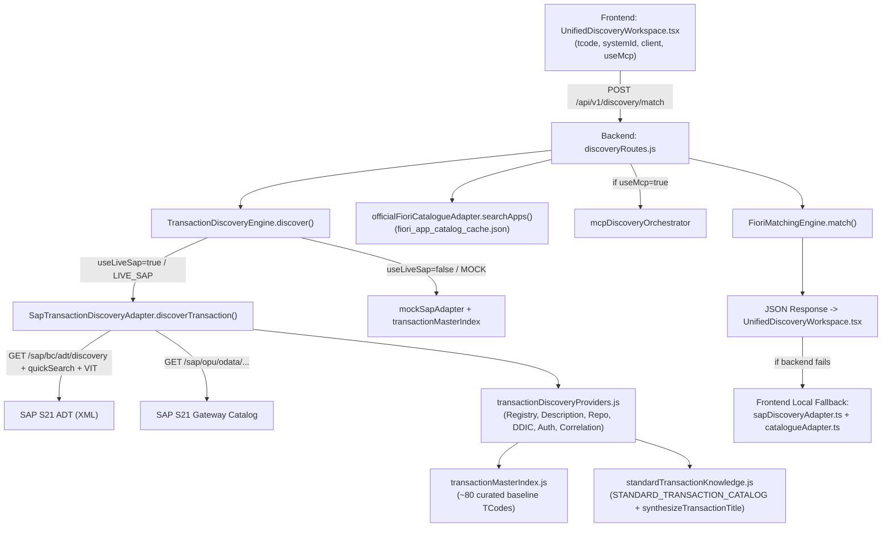

# FIORIFY — TRANSACTION DISCOVERY ENGINE
## A. Current Project Status Audit, Architecture & Execution Flow

**Audit Date:** 2026-11-26  
**Target Landscape:** SAP S/4HANA 2023 (System `S21`, Client `200`, `S4CORE 108`, `SAP_BASIS 758`)  
**Scope:** Investigation-only technical & functional audit of Transaction Discovery (Zero code changes, zero SAP mutations).

---

## 1. Executive Summary

The Fiorify Transaction Discovery module implements a multi-layered architecture across React frontend (`UnifiedDiscoveryWorkspace.tsx`), Node.js backend (`discoveryRoutes.js`, `TransactionDiscoveryEngine`, `SapTransactionDiscoveryAdapter`), a local Master Snapshot (`transactionMasterIndex.js`, `standardTransactionKnowledge.js`), and an Official Fiori Catalogue cache (`officialFioriCatalogueAdapter.js`, `fiori_app_catalog_cache.json`).

**Key Finding:** While the structural scaffolding, syntax validation, and decoupling patterns exist, **data accuracy for transactions outside the curated ~80-TCode baseline snapshot (such as `MD07`, `MD01`, `KSB1`) is broken or misleading**, and at least one curated entry (**`KO01`**) maps to an incorrect Fiori application (**`F1444 — Manage Profit Centers`**). Furthermore, **direct SAP DDIC table reads (`TSTC`, `TSTCT`, `TADIR`, `TDEVC`, `CVERS`) are not implemented** in live mode—live SAP inspection relies solely on SAP ADT XML endpoints (`/sap/bc/adt/...`) and Gateway catalog correlation, and **falls back to synthetic titles, `CUSTOM` misclassifications, and `'Pending DDIC Read'` / `'0100'` / `'S4CORE 108'` UI defaults** when ADT or snapshot data is unavailable.

---

## 2. Actual Architecture & Data Flow

---

## 3. Exact Data Source & Priority Order (Per Field)

| Field | Priority Order in Actual Code |
|---|---|
| **1. Transaction Existence** | `1.` Syntax validator (`validateTcodeSyntax`) → `2.` `transactionMasterIndex.lookup(tcode)` → `3.` Live SAP ADT `quickSearch` / `VIT` XML (`sapTransactionDiscoveryAdapter.js`) → `4.` `PENDING_VERIFICATION` (Live) or `exists: false / NOT_FOUND` (Mock, `transactionDiscoveryEngine.js:372-373`). **Never queries `TSTC` directly.** |
| **2. Transaction Description** | `1.` Hardcoded `multilingualDescriptions` (`transactionDiscoveryProviders.js:285-305`, 19 TCodes) → `2.` `transactionMasterIndex` snapshot → `3.` Live ADT `adtcore:description` → `4.` Correlated Gateway service description → `5.` `synthesizeTransactionTitle(tcode)` prefix heuristic (e.g., `MD07` → `"Production Planning & Orders (MD07)"`). **Never queries `TSTCT` directly.** |
| **3. ABAP Program (`PGMNA`)** | `1.` `transactionMasterIndex` (`SAPLMEGUI_DEMO` in mock) → `2.` Live ADT `VIT` XML (`programName`/`PGMNA`) → `3.` `'PENDING_VERIFICATION'` (Backend) → `4.` `'Pending DDIC Read'` (Frontend `UnifiedDiscoveryWorkspace.tsx:250`). **Never queries `TSTC-PGMNA` directly.** |
| **4. Screen Number (`DYPNO`)** | `1.` `transactionMasterIndex` → `2.` Live ADT `VIT` XML → `3.` Hardcoded `'0100'` (`transactionDiscoveryProviders.js:398, 424` and `UnifiedDiscoveryWorkspace.tsx:251`). **Never queries `TSTC-DYPNO` directly.** |
| **5. ABAP Package (`DEVCLASS`)** | `1.` `transactionMasterIndex` → `2.` Live ADT `adtcore:packageName` → `3.` `'Z_PENDING_VERIFICATION'` (if `Z*`/`Y*`) or `'PENDING_VERIFICATION'` → `4.` `'Pending DDIC Read'` or `'Z_CUSTOM'` (Frontend `UnifiedDiscoveryWorkspace.tsx:252`). **Never queries `TADIR-DEVCLASS` or `TDEVC` directly; program's own package is never resolved separately.** |
| **6. Application Component** | Not queried from SAP `TDEVC` / `DF14L`. Derived solely from static `STANDARD_SAP_TRANSACTION_REGISTRY[tcode].functionalArea` or defaults to `'SAP Core'` (`sapTransactionDiscoveryAdapter.js:560`). |
| **7. Software Component** | Hardcoded `'HOME'` (if `Z*`/`Y*`) or `'S4CORE 108'` (`transactionDiscoveryProviders.js:375, 388, 400` and `UnifiedDiscoveryWorkspace.tsx:254`). **Never queries `CVERS` directly.** |
| **8. Fiori Successors** | `1.` `officialFioriCatalogueAdapter.searchApps()` against `fiori_app_catalog_cache.json` + `STANDARD_TRANSACTION_CATALOG` → `2.` Optional MCP (`useMcp`) → `3.` `FioriMatchingEngine.match()`. |

---

## 4. API & Integration Inventory

| Endpoint | File & Handler | Input | Data Source | Live S21 Connected? |
|---|---|---|---|---|
| `POST /api/v1/discovery/match` & `/mcp-assisted` | `backend/src/routes/discoveryRoutes.js:694-890` | `tcode`, `systemId`, `client`, `useLiveSap`, `useMcp`, `targetRelease` | `TransactionDiscoveryEngine` + `officialFioriCatalogueAdapter` + `FioriMatchingEngine` | Only if `useLiveSap=true` & BTP destination `S21_FIORI` reachable; otherwise snapshot/mock. |
| `POST /api/v1/tcode-search` | `backend/src/routes/discoveryRoutes.js:221-585` | `tcode`, `systemId`, `client`, `useLiveSap` | `TransactionDiscoveryEngine.discover()` | Same as above. |
| `GET /api/v1/transaction-discovery/:tcode` | `backend/src/routes/discoveryRoutes.js:195-218` | `:tcode` | `sapTransactionDiscoveryAdapter.discoverTransaction()` | Probes `/sap/bc/adt/discovery` & Gateway catalog via `btpDestinationAdapter`. |
| `POST /api/v1/discovery/executions` | `backend/src/routes/discoveryRoutes.js:34-67` | `systemProfileId`, `targetTcodes` | `transactionDiscoveryService.executeDiscovery()` | Batch/persistence service over `masterIndex` / `sapAdapter`. |

---

## 5. Honest Subsystem Status Classification

| # | Subsystem | Status | Justification (Verified Evidence) |
|---|---|---|---|
| 1 | **Transaction Identification** | **PARTIALLY WORKING** | Syntax validation (`validateTcodeSyntax`) works; ~80 baseline TCodes resolve via `masterIndex`. Outside snapshot in mock mode, `MD07` returns `success: true` with `exists: false` and `classification: 'CUSTOM'`. |
| 2 | **Description Resolution** | **PARTIALLY WORKING** | Multilingual map (19 TCodes) and `masterIndex` (~80 TCodes) work. Unindexed TCodes (`MD07`, `MD01`, `KSB1`) return synthesized prefix strings (`"Production Planning & Orders (MD07)"`), not `TSTCT` text. |
| 3 | **DDIC Inspection** | **BROKEN** | Direct `TSTC`, `TSTCT`, `TADIR`, `TDEVC`, `CVERS` queries are not implemented. `DDICMetadataProvider` hardcodes `screenNumber: '0100'` and `sourceTables: ['TSTC', 'TSTCT']`. |
| 4 | **Program Resolution (`PGMNA`)** | **PARTIALLY WORKING** | Works for `masterIndex` (though `ME21N`/`VA01` show `_DEMO` suffixes in mock mode) and ADT VIT XML if accessible; otherwise `'PENDING_VERIFICATION'` → frontend `'Pending DDIC Read'`. |
| 5 | **Package Resolution (`DEVCLASS`)** | **PARTIALLY WORKING** | Works for `masterIndex` (except `FBL1N` which has `package: null`) and ADT if accessible; program package vs transaction package distinction is not implemented. |
| 6 | **Component Classification** | **BROKEN** | Functional application component (`PP-MRP`, `CO-OM`, etc.) is not queried from SAP; `S4CORE 108` (software component) is hardcoded as a fallback for non-`Z*` TCodes. |
| 7 | **SAP Connectivity** | **BLOCKED / NOT VERIFIED** | Live S21 connectivity via `btpDestinationAdapter` (`S21_FIORI`) requires BTP Destination/Connectivity bindings (`env` warning in local tests: `Could not find service binding of type 'destination'`). Direct live S21 probe not executed in this read-only audit. |
| 8 | **Fiori Catalogue Retrieval** | **PARTIALLY WORKING** | `fiori_app_catalog_cache.json` loads 18,000+ apps (including `F2101A`, `F0247A`, `F0251A`), but many cached entries have `leadingTransactionCodes: []` and `applicationComponent: undefined`. |
| 9 | **Successor Matching** | **BROKEN** | `MD07` returns `0` candidates (`NO_MATCH_CONFIRMED`) despite `F2101A`/`F0247A`/`F0251A` existing in cache; `KO01` (Internal Order) falsely matches `F1444` (Manage Profit Centers) as `VERIFIED_SUCCESSOR`. |
| 10 | **Functional Fit-Gap Assessment** | **PARTIALLY WORKING** | Works for curated TCodes with known apps, but relies on matching output—so `NO_MATCH_CONFIRMED` on `MD07` produces an inaccurate 100% gap. |
| 11 | **Custom RAP Recommendation** | **PARTIALLY WORKING** | Correctly triggers when 0 apps match, but triggers **falsely** for standard SAP transactions (`MD07`, `MD01`, `KSB1`) that simply missed catalogue/index matching. |
| 12 | **Frontend Result Rendering** | **PARTIALLY WORKING** | Displays backend response, but masks missing fields with `'Pending DDIC Read'`, `'0100'`, `'S4CORE 108'`, and silently falls back to local mock adapters on backend error. |
| 13 | **Error Handling** | **PARTIALLY WORKING** | `sapTransactionDiscoveryAdapter` distinguishes 403/502/504, but silently converts Gateway failure into `{ success: true, services: [], isOfflineFallback: true }` unless `strictLive === true`. |
| 14 | **Automated Test Coverage** | **WORKING (WITH GAPS)** | Existing unit/integration suites pass for mocked/curated scenarios, but did not catch `KO01 -> F1444` false positive or `MD07 -> CUSTOM / 0 apps` miss. |
