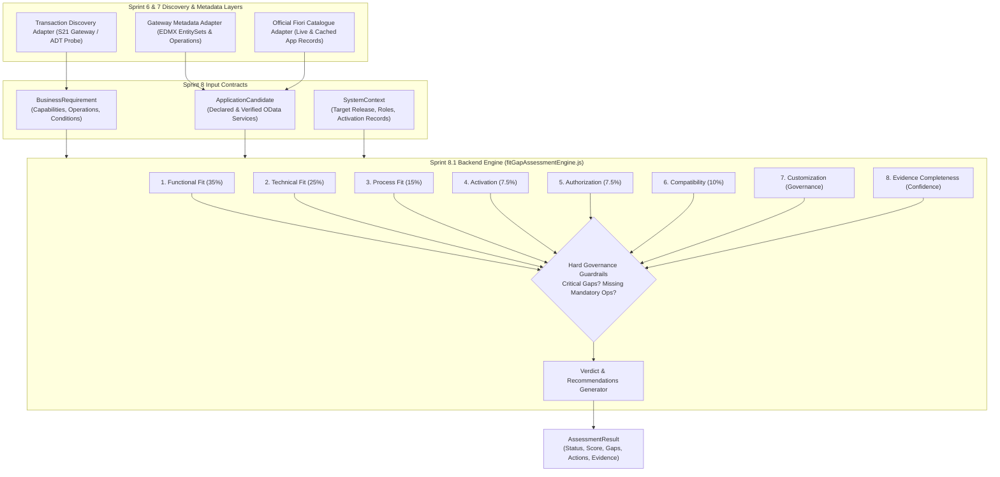

# Fiorify Sprint 8.1: Backend Fit-Gap Assessment Engine Implementation Report
**Date:** November 5, 2026  
**Stage:** Stage 1 — Backend Fit-Gap Engine Implementation  
**Status:** Completed & Verified  
**Component:** `backend/src/engine/fitGapAssessmentEngine.js`  
**Test Suite:** `backend/test/sprint8FitGapEngine.test.js`  
**Backend Test Results:** 71 passed (10 suites, 0 failures)  
**Frontend Test Results:** 61 passed (4 suites, 0 failures)  

---

## 1. Executive Summary

In **Sprint 8.1 (Stage 1)**, Fiorify successfully delivered the core backend **Fit-Gap Assessment Engine** (`fitGapAssessmentEngine.js`).

This engine takes a business requirement and evaluates discovered SAP Fiori candidate applications (`F1612`, `F-53` classic tile, `F1367`) across 8 independent assessment dimensions. It executes **pure, deterministic, in-memory evaluation logic** without making outbound network or SAP calls, ensuring 100% offline predictability and benchmark reproducibility.

### Key Milestones Achieved:
1. **Pure & Deterministic Evaluation Logic:** Complete decoupling of evaluation logic from external I/O.
2. **Strict Governance Guardrails:** Enforced that missing mandatory capabilities or operations strictly prevent an overall `VERIFIED_FIT`, even if the technical OData score is 100%.
3. **Transparent Unknown Tracking:** Unknown user PFCG authorizations and target system activation statuses remain explicitly `PENDING_VERIFICATION` and generate actionable investigation tasks instead of false rejections or assumed passes.
4. **Z-Service Alias Disambiguation:** Required customer Z-prefixed service aliases (e.g. `ZFAP_PAYMENT_POST_SRV`) to have verified schema contracts before counting toward verified technical fit.
5. **F-53 Benchmark Verification:** Accurately evaluated `F1612` as `PARTIAL_FIT` (primary posting app), `F-53` as `CLASSIC_GUI_FALLBACK` (preserving legacy Dynpro scope), and `F1367` as a companion clearing app (not a direct payment posting alternative).

---

## 2. Architecture & Pure Execution Model

The Fit-Gap Assessment Engine operates downstream of the Sprint 6 and Sprint 7 discovery layers:

### Pure Engine Invariants:
- **Zero I/O:** The engine accepts pure data objects and returns pure assessment results.
- **No Mock Injection into Live Data:** When evaluating live candidate records, the engine inspects actual declared OData services and parsed FunctionImports without fabricating placeholder values.
- **Configurable Weights:** Scoring weights are isolated from verdict logic and can be adjusted per enterprise evaluation policy.

---

## 3. Data Structures & Schema Definitions

The engine defines and validates 6 core data models:

### 3.1. `BusinessRequirement`
Defines the functional and technical demands of the business user:
- `id`: Unique identifier (e.g. `REQ-FI-001`).
- `title`: Short descriptive title.
- `description`: Detailed functional scope.
- `businessProcess`: Process taxonomy (e.g. `"Finance, Accounts Payable"`).
- `tcode`: Associated legacy transaction code (e.g. `"F-53"`).
- `requiredCapabilities`: Array of required capability identifiers (e.g. `['OUTGOING_PAYMENT_POSTING', 'OPEN_ITEM_CLEARING', 'CASH_DISCOUNT']`).
- `requiredOperations`: Array of required backend operations (e.g. `['PostPayment', 'SimulatePayment']`).
- `mandatoryConditions`: Array of non-negotiable operational conditions.
- `optionalConditions`: Desired but non-blocking criteria.
- `priority`: `MANDATORY`, `HIGH`, `MEDIUM`, or `LOW`.
- `customizationRequirements`: Specific custom screen variants or user exit behaviors.

### 3.2. `ApplicationCandidate`
Defines the standard Fiori application under evaluation:
- `appId`: Unique Fiori App ID (e.g. `F1612`, `F-53`, `F1367`).
- `appName`: Application title.
- `appType`: `Transactional`, `Analytical`, `Fact Sheet`, or `SAP GUI`.
- `uiTechnology`: `SAP Fiori (SAPUI5)`, `SAP GUI for HTML`, etc.
- `productVersion`: Compatible backend/frontend software release.
- `businessRoles`: Standard business role assignments from the catalogue.
- `odataDependencies`: Declared backend OData services.
- `verifiedODataServices`: Array of active services verified on the target SAP system, including parsed `availableOperations` and `entitySetsCount`.
- `supportedCapabilities`: Known functional capabilities supported by the app.

### 3.3. `GapRecord`
Structured record of an identified functional or technical discrepancy:
- `gapId`: Unique gap identifier (e.g. `GAP-FUNC-F1612-1`).
- `description`: Human-readable discrepancy description.
- `category`: `FUNCTIONAL_CAPABILITY`, `TECHNICAL_DEPENDENCY`, `AUTHORIZATION`, `CUSTOM_VARIANT`, `ACTIVATION`, or `COMPATIBILITY`.
- `severity`: `CRITICAL`, `MAJOR`, `MINOR`, or `INFO`.
- `missingInformation`: Explicit list of missing data points.
- `recommendedInvestigation`: Actionable recommendation for functional consultant or Basis team.

### 3.4. `EvidenceRecord`
Full traceability record backing each dimension:
- `evidenceId`: Identifier (e.g. `EVD-TECH-F1612`).
- `evidenceType`: `ODATA_METADATA`, `OFFICIAL_CATALOGUE`, `SYSTEM_PROFILE`, etc.
- `source`: Authoritative endpoint or documentation URI.
- `retrievedValue`: Actual value or operation list extracted.
- `verificationStatus`: `VERIFIED_LIVE`, `VERIFIED_CATALOGUE`, `PARTIALLY_AVAILABLE`, or `NOT_AVAILABLE`.
- `confidence`: `HIGH`, `MEDIUM`, or `LOW`.
- `explanation`: Contextual evaluation rationale.

### 3.5. `AssessmentResult`
The comprehensive output produced by `evaluate()`:
- `overallStatus`: `VERIFIED_FIT`, `PARTIAL_FIT`, `POSSIBLE_FIT`, `NO_FIT`, `PENDING_VERIFICATION`, or `INSUFFICIENT_EVIDENCE`.
- `overallScore`: Weighted score (0 - 100).
- `scoringBreakdown`: Scores per dimension and active weighting configuration.
- `dimensionResults`: Detailed evaluation per dimension.
- `verifiedCapabilities`, `unverifiedCapabilities`, `missingCapabilities`.
- `verifiedOperations`, `missingOperations`.
- `identifiedGaps`: Array of `GapRecord`.
- `missingEvidence`: Array of unconfirmed data items.
- `conflictingEvidence`: Discrepancies detected between sources.
- `confidence`: Overall confidence assessment.
- `recommendation`: Recommended verdict (`RECOMMENDED_STANDARD`, `RECOMMENDED_WITH_GAPS`, `CLASSIC_GUI_FALLBACK`, `CUSTOM_REQUIRED`, `ASSESSMENT_INCONCLUSIVE`) with next actions.

---

## 4. Scoring Model & Dimension Mapping

The 8 assessment dimensions are mapped to 5 configurable scoring groups without double counting:

| Scoring Group | Default Weight | Source Dimension(s) | Scoring Rationale |
| :--- | :---: | :--- | :--- |
| **Functional Fit** | **35%** | `FUNCTIONAL_FIT` | Ratio of verified business capabilities to required capabilities. Unverified capabilities receive 40% partial credit. |
| **Technical Fit** | **25%** | `TECHNICAL_FIT` | Blended score: 60% OData service availability + 40% required backend operations verification. |
| **Process Alignment** | **15%** | `PROCESS_FIT` | Evaluates whether candidate line of business aligns with the target business process taxonomy. |
| **Activation & Roles** | **15%** | `ACTIVATION` (50%) `AUTHORIZATION` (50%) | Balanced readiness: 50% Gateway service activation + 50% PFCG user role assignment readiness. |
| **Compatibility** | **10%** | `COMPATIBILITY` | Verified product release compatibility against target S/4HANA release (e.g. 2023). |

### Independent Dimensions:
- **`CUSTOMIZATION` (Governance Dimension):** Evaluated independently. If legacy Dynpro user exits or screen modifications cannot be executed in standard Fiori elements, it generates a `MAJOR` gap and restricts the verdict without distorting base technical availability.
- **`EVIDENCE_COMPLETENESS` (Confidence Dimension):** Calculates the ratio of verified evidence items to total evaluated items. Governs overall `confidence` (`HIGH`, `MEDIUM`, `LOW`, `VERY_LOW`) and triggers `INSUFFICIENT_EVIDENCE` when completeness is below 40%. It never artificially inflates functional fit scores.

---

## 5. Mandatory Governance Invariants

The engine enforces 9 strict governance rules:

1. **Missing Mandatory Capability:** If any capability marked in a `MANDATORY` requirement is missing, the engine generates a `CRITICAL` gap and strictly caps overall status at `PARTIAL_FIT` or `NO_FIT`.
2. **Missing Mandatory Operation:** If a required operation (e.g. `PostPayment`) is absent from the service's verified operations, a `CRITICAL` technical gap is logged, preventing `VERIFIED_FIT`.
3. **Missing Evidence $\neq$ Proof of Failure:** When evidence is missing (e.g. unknown user authorization), the dimension is marked `PENDING_VERIFICATION` rather than penalizing the application as a confirmed negative.
4. **Unknown Authorization Stays Unknown:** If PFCG role assignments are not supplied, authorization status is set to `PENDING_VERIFICATION`. Fiorify never assumes that catalogue role mentions imply granted access.
5. **Unknown Activation Stays Unknown:** If live SICF or Gateway activation records are absent, activation is marked `PENDING_VERIFICATION` with an actionable Basis task.
6. **Z-Service Alias Disambiguation:** A service alias using customer namespace `Z` (e.g. `ZFAP_PAYMENT_POST_SRV`) is accepted only when schema verification is established. Unverified aliases generate a `MAJOR` gap and surface as conflicting evidence.
7. **Technical Viability $\neq$ Functional Equivalence:** A 100% technical OData score cannot override functional gaps or Dynpro customizations.
8. **Critical Gaps Override High Numerical Scores:** Even if the mathematical score is 95%, the presence of a single `CRITICAL` gap forces the overall status to `PARTIAL_FIT`.
9. **Conflicting Evidence Surfaced:** Discrepancies between catalogue declarations and live system metadata are explicitly exposed in `conflictingEvidence`.

---

## 6. F-53 Benchmark Evaluation Results

The engine was benchmarked against the real discovery records for transaction `F-53` on SAP S/4HANA System S21 (Client 200):

| Candidate Application | Evaluated Status | Numerical Score | Key Findings & Verified Evidence | Recommended Verdict |
| :--- | :---: | :---: | :--- | :--- |
| **`F1612` (Post Outgoing Payments)** | `PARTIAL_FIT` | 84% | • Supports `OUTGOING_PAYMENT_POSTING` & `OPEN_ITEM_CLEARING` • Active backend service `ZFAP_PAYMENT_POST_SRV` (478 EntitySets, 53 operations) • Operations `PostPayment` and `SimulatePayment` verified • Gaps: Does not support complex standalone manual clearing with residual items (`GAP-FUNC-F1612-1`) | `RECOMMENDED_WITH_GAPS` Primary payment posting application; recommend pairing with companion app `F1367` for clearing. |
| **`F-53` (WebGUI Launchpad Tile)** | `PARTIAL_FIT` | 74% | • Preserves 100% of classic Dynpro `SAPMF05A` screen logic, exits, and special G/L keys • Zero OData dependencies required (standard ITS wrapper) • Gaps: Classic SAP GUI for HTML interface; full functional parity for bespoke Dynpro variants requires user verification | `CLASSIC_GUI_FALLBACK` Retain as fallback Launchpad tile for legacy or specialized posting scenarios. |
| **`F1367` (Clear Outgoing Payments)** | `PARTIAL_FIT` | 72% | • Supports `OPEN_ITEM_CLEARING` and `RESIDUAL_ITEMS` • Active backend service `ZFAP_MANUAL_CLEARING_SRV` (490 EntitySets, 53 operations) • Operation `ClearItems` verified • Critical Gap: Missing `PostPayment` operation and direct initial payment posting capability | `RECOMMENDED_WITH_GAPS` Specialized companion clearing application; not a replacement for direct payment posting. |

---

## 7. Test Coverage & Quality Verification

Test suite: `backend/test/sprint8FitGapEngine.test.js`  
Execution command: `npm --prefix backend test`

### Summary:
- **Total Tests in Engine Suite:** 19 tests across 2 describe blocks.
- **Passing:** 19 / 19 passed (100%).
- **Failures:** 0.
- **Platform-wide Backend Total:** **71 tests** across 10 test suites (0 failures).
- **Platform-wide Frontend Total:** **61 tests** across 4 test suites (0 failures).

### Tested Scenarios:
1. Complete verified fit with all criteria met (`VERIFIED_FIT`).
2. Partial fit with secondary capability missing (`PARTIAL_FIT`).
3. Possible fit with related process scope (`POSSIBLE_FIT`).
4. No fit with incompatible release or process divergence (`NO_FIT`).
5. Insufficient evidence on invalid or empty inputs (`INSUFFICIENT_EVIDENCE`).
6. Missing mandatory capability preventing `VERIFIED_FIT`.
7. Missing mandatory backend operation preventing `VERIFIED_FIT`.
8. Unknown authorization remaining `PENDING_VERIFICATION`.
9. Unknown activation remaining `PENDING_VERIFICATION`.
10. Unverified Z-service alias generating `MAJOR` gap and conflicting evidence.
11. Missing declared OData dependency generating `CRITICAL` technical gap.
12. Hard governance guardrail: critical gap preventing `VERIFIED_FIT` despite 100% technical score.
13. Conflicting evidence surfaced in assessment output.
14. Missing compatibility release metadata marked `PENDING_VERIFICATION`.
15. Customization impacts: Fiori elements partial fit vs WebGUI full Dynpro preservation.
16. Evidence completeness ratio and confidence level calculation.
17. F-53 benchmark: `F1612` as `RECOMMENDED_WITH_GAPS`.
18. F-53 benchmark: `F-53` classic tile as `CLASSIC_GUI_FALLBACK`.
19. F-53 benchmark: `F1367` as companion clearing app (not posting replacement).

---

## 8. Known Limitations & Next Steps

1. **In-Memory Logic:** Stage 1 implemented pure in-memory engine evaluation. Integration with HTTP server endpoints (`POST /api/v1/assessments/evaluate`) will be delivered in **Stage 2**.
2. **Frontend Wiring:** The React Assessment Workspace has not yet been connected to the new engine; this will be implemented in **Stage 3**.
3. **PFCG Authorization Data:** S21 user authorizations cannot currently be read from backend tables (`USOBX_C`, `AGR_1251`) due to ADT authorization restrictions (`SADT_RESOURCE_003`). User authorizations are accepted via `context.userAuthorizations` or marked `PENDING_VERIFICATION`.

---

## 9. Stage 1 Sign-Off

**Status:** **STAGE 1 COMPLETE & VERIFIED**  
All governance invariants, scoring weights, dimension models, and benchmark tests have been implemented and verified. The codebase is ready to proceed to **Stage 2 (API Endpoint Exposure)** upon review.
