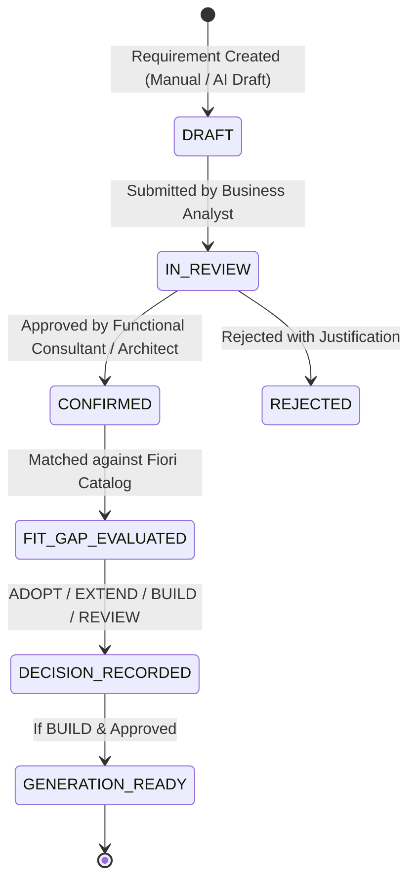

# Fiorify Requirement Traceability Matrix (RTM) & Requirements Quality Audit
**Project:** Fiorify — SAP S/4HANA On-Premise Fiori App Discovery, Assessment and Generation Platform  
**Document Version:** 1.0.0  
**Phase:** Pre-Development / R&D Governance Phase  

---

## 1. Overview & Traceability Structure

The Requirement Traceability Matrix (RTM) establishes bidirectional traceability across the entire lifecycle of the Fiorify platform:
- **Business Requirements (BR):** Strategic objectives from `docs/02-business-requirements.md`
- **Functional Requirements (FR):** System capabilities from `docs/03-functional-requirements.md` and `docs/01-prd.md`
- **Feature Register (FEAT):** Release-scoped features from `docs/features.md`
- **Solution Architecture Components (ARCH):** Subsystems and workers from `docs/07-solution-architecture.md`
- **API Contracts (API):** Service endpoints from `docs/15-api-contracts.md`
- **Database Entities (DB):** Relational models from `docs/14-database-data-model.md`
- **Validation & Test Cases (TC):** Testing and verification levels from `docs/18-validation-testing.md`

---

## 2. Comprehensive Traceability Matrix

| BR ID | Business Requirement | Functional Req (FR) | Feature (FEAT) | Architecture Component (ARCH) | API Endpoint (API) | Database Entity (DB) | Test Verification Layer (TC) |
|---|---|---|---|---|---|---|---|
| **BR-01** | Reduce manual effort assessing SAP GUI transactions for Fiori adoption | FR-SYS: System Management FR-EXP: Transaction Explorer FR-DISC: Technical Discovery | FEAT-01: System Registration FEAT-02: Single T-Code Assessment FEAT-03: Async Discovery Job FEAT-04: Metadata & Repo Discovery | `UI` (Explorer) `CAP` (Main) `JOB` (Orchestrator) `DISC` (Worker) `DEST` (Destination) `CONN` (Connectivity) `SCC` (Cloud Connector) | `POST /api/v1/systems` `POST /api/v1/systems/{id}/connection-tests` `POST /api/v1/transactions/analyze` `GET /api/v1/jobs/{id}` `GET /api/v1/assessments/{id}` `GET /api/v1/assessments/{id}/technical-objects` | `SAP_SYSTEM` `SYSTEM_RELEASE` `SYSTEM_CAPABILITY` `TRANSACTION` `ASSESSMENT` `SCAN_JOB` `TRANSACTION_SNAPSHOT` `REPOSITORY_OBJECT` `DISCOVERY_EVIDENCE` | **TC-INT-01:** Cloud Connector Ping **TC-CON-01:** ADT Discovery Contract **TC-RES-01:** SAP Offline & Timeout Handling **TC-UAT-01:** Turnaround time < 5 min vs. manual (hours) |
| **BR-02** | Evaluate standard Fiori before custom build | FR-CAT: Fiori Catalogue Search FR-FIT: Fit-Gap Evaluation FR-DEC: Decision Engine | FEAT-07: Curated Fiori Catalogue FEAT-08: Requirement-level Fit-Gap FEAT-09: Adopt/Extend/Build Decision | `UI` (Catalogue & Fit-Gap) `CAP` (Domain Logic) `CAT` (Catalogue Worker) `DB` (HANA Cloud) | `GET /api/v1/fiori-apps` `POST /api/v1/assessments/{id}/fit-gap-runs` `POST /api/v1/assessments/{id}/decisions` | `FIORI_APP` `APP_RELEASE` `APP_PREREQUISITE` `APP_CAPABILITY` `REQUIREMENT_MATCH` `MATCH_EVIDENCE` `RECOMMENDATION` `DECISION_REVIEW` | **TC-UNT-01:** Recommendation Policy Rule Unit Test **TC-UNT-02:** Build Decision Guard Test (reject Build if standard match > 90%) **TC-UAT-02:** Functional Reviewer Fit-Gap Acceptance |
| **BR-03** | Explain findings to business and technical users | FR-EXP: Technical Explorer FR-BUS: Business Context FR-FIT: Fit-Gap Summary | FEAT-05: Technical Explorer & Modal FEAT-06: Business Context Capture FEAT-08: Fit-Gap Explanation | `UI` (Fiorify Workbench) `CAP` (Reporting Service) `DB` (HANA Cloud) | `GET /api/v1/assessments/{id}` `GET /api/v1/assessments/{id}/technical-objects` `GET /api/v1/assessments/{id}/fit-gap-runs` | `ASSESSMENT` `REPOSITORY_OBJECT` `BUSINESS_CONTEXT` `REQUIREMENT_MATCH` `DISCOVERY_EVIDENCE` | **TC-UI-01:** Responsive Drill-down and Modal Inspection **TC-SEC-01:** Read-only Masking for Technical Payloads **TC-UAT-03:** Architect and Consultant Information Accessibility |
| **BR-04** | Capture company-specific rules | FR-BUS: Business & Functional Analysis FR-REQ: Requirement Management | FEAT-06: Business Context Capture & Consultant Confirmation | `UI` (Requirement Workspace) `CAP` (Domain Logic) `DB` (HANA Cloud) | `POST /api/v1/assessments/{id}/requirements` `GET /api/v1/assessments/{id}/requirements` | `BUSINESS_PROCESS` `BUSINESS_ACTIVITY` `BUSINESS_CONTEXT` `REQUIREMENT` `BUSINESS_RULE` `REQUIREMENT_SOURCE` `REQUIREMENT_REVIEW` | **TC-UNT-03:** Requirement Lifecycle Transition (DRAFT -> CONFIRMED -> REJECTED) **TC-SEC-02:** Role-based Confirmation (Consultant/Architect only) |
| **BR-05** | Identify partial and unsupported capabilities | FR-FIT: Fit-Gap Multi-State Evaluation | FEAT-08: Fit-Gap Multi-status Matrix (SUPPORTED, PARTIAL, UNSUPPORTED, UNKNOWN) | `UI` (Fit-Gap Matrix) `CAP` (Fit-Gap Engine) `CAT` (Worker) `DB` (HANA Cloud) | `POST /api/v1/assessments/{id}/fit-gap-runs` `GET /api/v1/assessments/{id}/fit-gap-runs` | `REQUIREMENT_MATCH` `MATCH_EVIDENCE` `APP_CAPABILITY` `REQUIREMENT` | **TC-UNT-04:** Unknown != Unsupported Invariant Test **TC-UNT-05:** Partial Status Flagging on Missing Annotation |
| **BR-06** | Generate reviewable custom app draft where justified | FR-GEN: Custom Fiori Generation FR-VAL: Validation & Approval Governance | FEAT-10: Generation Specification FEAT-11: Reference Draft Pattern FEAT-12: Validation & Review Gate | `UI` (Generation Studio) `CAP` (Orchestration) `GEN` (Generation Worker) `VAL` (Validation Worker) `DOC` (Document Repository) | `POST /api/v1/assessments/{id}/generation-projects` `GET /api/v1/generation-projects/{id}/artifacts` `POST /api/v1/generation-projects/{id}/validation-runs` `POST /api/v1/generation-projects/{id}/approvals` | `GENERATION_PROJECT` `APP_SPECIFICATION` `TEMPLATE_VERSION` `GENERATED_ARTIFACT` `VALIDATION_RUN` `VALIDATION_FINDING` `APPROVAL` | **TC-UNT-06:** Generator AST / Template Compilation Test **TC-INT-02:** UI5 Linter & Build Validation Check **TC-CON-02:** Release Compatibility Template Schema Check **TC-SEC-03:** Generated Draft Integrity & Checksum Verification |
| **BR-07** | Provide security, governance and audit | FR-SYS: Authentication & System Security FR-GOV: Audit Logging & Traceability | FEAT-00: Auth & RBAC Navigation FEAT-13: Assessment History & Audit Trace | `AR` (App Router) `ID` (XSUAA/IAS) `CAP` (Security Interceptor) `DB` (HANA Cloud) | `GET /api/v1/audit-events` All authenticated routes | `USER_PROFILE` `ROLE` `USER_ROLE` `SYSTEM_PERMISSION` `AUDIT_EVENT` | **TC-SEC-04:** XSUAA JWT Token & Role Collection Verification **TC-SEC-05:** IDOR Prevention & Tenant Isolation Test **TC-SEC-06:** Audit Event Generation on Sensitive Mutations |
| **BR-08** | Expand to bulk and landscape scans | FR-EXP: Bulk Excel Upload FR-EXP: System-Wide Background Scans | FEAT-14: Bulk Upload (Deferred) FEAT-15: System Scan (Deferred) | `UI` (Bulk Scanner) `CAP` (Batch Service) `JOB` (Queue Engine) `DISC` (Worker Pool) | `POST /api/v1/scans` `GET /api/v1/scans/{id}` | `SCAN_SCOPE` `SCAN_JOB` `SCAN_RESULT` | **TC-RES-02:** High Concurrency Job Throttling **TC-PERF-01:** 500 T-Code Batch Ingestion Benchmark *(Sprint 14)* |

---

## 3. Analysis of Requirements Quality

### 3.1 Contradictions Identified Across Documents

1. **API Protocol Contradiction (CAP OData V4 vs. Express-style REST):**
   - *Conflict:* `docs/06-engineering-stack.md` and `docs/15-api-contracts.md` dictate RESTful APIs with paths like `POST /api/v1/transactions/analyze` and `GET /api/v1/assessments/{id}`. In contrast, `docs/05` and `docs/07` mandate standard SAP CAP (Node.js) with SAPUI5.
   - *Impact:* SAP CAP's default convention generates OData V4 services (`/odata/v4/assessment/Assessments`). SAPUI5 Smart Controls and Freestyle UI5 models bind natively to OData metadata. Forcing pure REST across all entity operations creates redundant manual controller code and defeats CAP's automated CQN querying, paging, and sorting.
   - *Resolution:* Adopt hybrid protocol governance: Use CAP OData V4 for all standard entity queries and data bindings (`/odata/v4/*`), and use CAP Actions/Functions or targeted REST routes (`/api/v1/jobs/*`) solely for long-running orchestration commands.

2. **Automated Activation vs. Draft-Only Governance Boundary:**
   - *Conflict:* `docs/18-validation-testing.md` specifies "SAP-side checks: object existence, CDS syntax/activation in DEV, service binding and OData metadata". However, `docs/00`, `docs/03`, and `docs/12` explicitly state "Generated code is a draft; no automatic production activation or transport initially" and "Initial connector is read-only".
   - *Impact:* Activation of an ABAP object or CDS view in S/4HANA requires write privileges (`S_DEVELOP` 02 Create/Change, 07 Activate) and transport assignment (`TRCORR`). If the connector is strictly read-only, automated SAP-side activation is technically impossible.
   - *Resolution:* Reclassify SAP-side activation checks in `docs/18` as **Phase 2 / Manual Dev Sandbox Import checks**. Sprint 1–12 validation must be strictly bounded to **client-side offline verification** (UI5 linter, CDS syntax verification via parser, JSON Schema compliance).

3. **Storage Mechanism Ambiguity:**
   - *Conflict:* `docs/07-solution-architecture.md` depicts `DOC[Durable Document Repository]` connected to `GEN[Generation Worker]`. `docs/05` lists SAP Document Management Service (DMS) as "Conditional on entitlement". `docs/21` states "Otherwise use an organisation-approved durable repository".
   - *Impact:* If neither DMS nor an S3/Azure Blob object store is entitled, Cloud Foundry's ephemeral container filesystem will result in silent artifact loss upon container restart.
   - *Resolution:* Add a formalized fallback storage driver in CAP: If DMS is not bound, store draft project text/ZIP artifacts in a dedicated HANA Cloud table (`GENERATED_ARTIFACT_CONTENT`) with a strict 10 MB size limit per artifact.

---

### 3.2 Duplicate and Overlapping Requirements

1. **System Registration & Capability Check:**
   - *Duplication:* `docs/01-prd.md` ("select SAP system"), `docs/03-functional-requirements.md` ("Register system alias... test connection"), and `docs/15-api-contracts.md` (`POST /systems`, `POST /systems/{id}/connection-tests`) redundantly specify connection testing.
   - *Consolidation:* Group under unified requirement `REQ-SYS-01` (System Registry and Live Capability Probing).

2. **Fit-Gap Recommendation Calculation:**
   - *Duplication:* `docs/02-business-requirements.md` (Decision Policy), `docs/03-functional-requirements.md` (Decision), and `docs/11-fiori-catalogue-fit-gap.md` (Decision logic) define the same 4-tier decision taxonomy (ADOPT, EXTEND, BUILD, REVIEW).
   - *Consolidation:* Group under unified functional requirement `REQ-FIT-02` (Deterministic Multi-State Fit-Gap Engine).

---

### 3.3 Missing Acceptance Criteria & Remediation

| Requirement ID | Original Specification Statement | Defect / Missing Criteria | Remediation & Quantified Acceptance Criteria |
|---|---|---|---|
| **BR-01** | "Complete pilot assessment" | Lacks execution time, payload size, and failure threshold metrics. | **Quantified Acceptance Criteria:** 1. System executes end-to-end discovery of pilot T-Code within **< 60 seconds** on standard Cloud Connector connection. 2. Gracefully handles up to 500 linked repository objects without browser crash. 3. Zero data corruption or unhandled promise rejections on network timeout. |
| **BR-03** | "Summary plus drill-down" | Lacks visual and structural requirements for what constitutes an explanation. | **Quantified Acceptance Criteria:** 1. Summary view displays: T-Code, Program, Package, Authorization Objects, and Standard Fiori Matches. 2. Technical drill-down modal reveals raw source line references, object type, and discovery timestamp. 3. Every displayed fact carries an explicit provenance tag (`LIVE_SAP`, `CURATED_CATALOG`, or `AI_ADVISORY`). |
| **BR-04** | "Functional reviewer confirms" | Lacks state transition rules and audit record criteria. | **Quantified Acceptance Criteria:** 1. Requirements remain in `DRAFT` status until explicitly transitioned to `CONFIRMED` by a user with role `Fiorify_Consultant` or `Fiorify_Architect`. 2. Every status transition records `user_id`, `timestamp`, and mandatory `confirmation_rationale`. 3. An unconfirmed requirement cannot be used to justify a `BUILD` decision. |
| **BR-06** | "Validated reference pattern" | Does not specify what files, structure, and standards must be generated. | **Quantified Acceptance Criteria:** 1. Generated draft contains valid SAP Fiori Elements project structure: `manifest.json`, `Component.js`, `annotations.cds`, and `xs-app.json`. 2. Passes `ui5 lint` with 0 errors. 3. ABAP CDS entity template compiles cleanly against target S/4HANA release syntax rules. |

---

### 3.4 Unclear Terminology & Semantic Ambiguities

1. **"T-Code Discovery":**
   - *Ambiguity:* The term suggests an automated mapping directly from a Transaction Code to a modern Fiori application.
   - *Technical Reality:* A T-Code in SAP is merely a pointer in table `TSTC` to an executable program (PROG), screen (DYNP), or transaction variant. It does not carry modern entity semantics.
   - *Clarified Definition:* "T-Code Structural Metadata Extraction" — the process of identifying the primary ABAP program, package, data tables, and authorization objects statically linked to a transaction code.

2. **"Unknown is not Unsupported":**
   - *Ambiguity:* In fit-gap analysis, an unverified capability might be misinterpreted as a gap justifying custom code generation.
   - *Clarified Definition:* `UNKNOWN` signifies insufficient metadata in the catalog or SAP repository; it mandates human investigation (`REVIEW`) and strictly prohibits auto-justifying a `BUILD` decision.

3. **"Clean Core Generation":**
   - *Ambiguity:* Mentioned in `docs/18-validation-testing.md` without qualification.
   - *Clarified Definition:* Compliance with SAP ABAP Cloud Tier 1 rules (released CDS views, released APIs, zero direct modification of standard SAP tables, strict usage of RAP managed/unmanaged frameworks).

---

## 4. Requirement Verification & Sign-Off Workflow

This RTM serves as the definitive reference for sprint verification, test planning, and project governance throughout the Fiorify implementation lifecycle.
