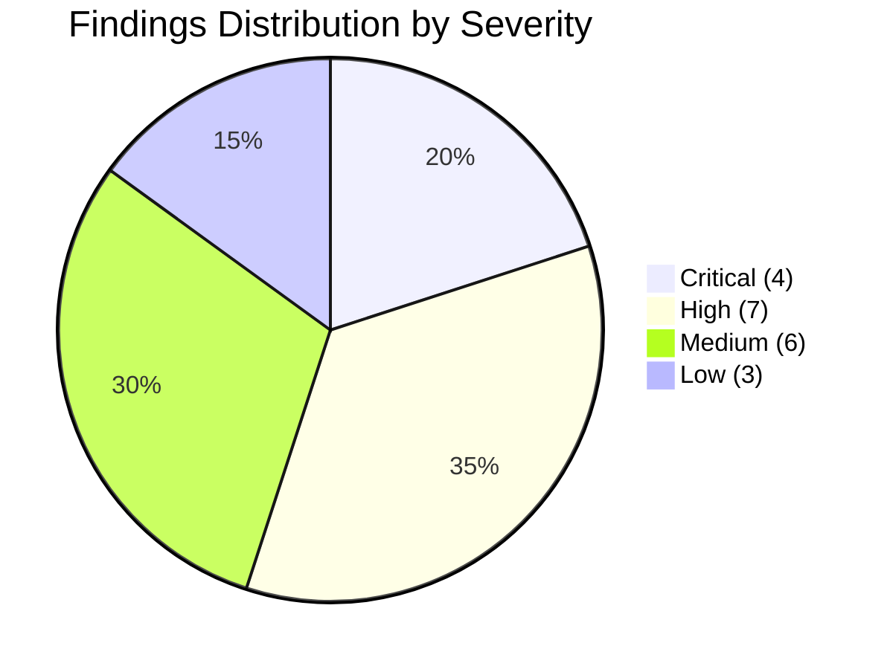
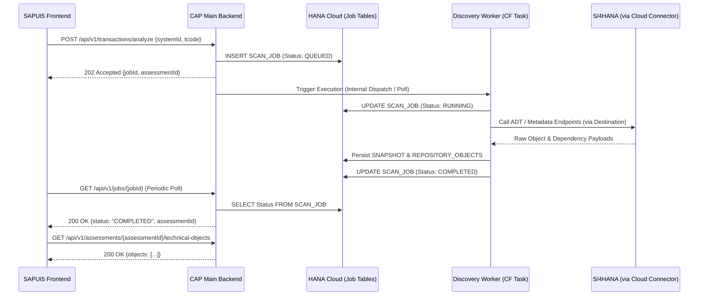

# Sprint 01 Repository and Specification Audit Report
**Project:** FioriX — SAP S/4HANA On-Premise Fiori App Discovery, Assessment and Generation Platform  
**Role:** Principal Software Architect & SAP S/4HANA Technical Architect  
**Audit Date:** November 2026  
**Document Version:** 1.0.0  
**Phase:** Pre-Development / R&D Governance Phase  

---

## 1. Executive Summary

A comprehensive architectural, technical, and specification audit of the FioriX repository was conducted, covering `README.md`, `FioriX_Master_Specification.md`, `docs/features.md`, and all 24 numbered specification documents (`docs/00-project-charter.md` through `docs/23-sap-references.md`).

### Context and Baseline
FioriX is designed as a governed, enterprise-grade workbench hosted on **SAP BTP Cloud Foundry** using **SAP CAP (Node.js/TypeScript)**, **SAP HANA Cloud**, and **SAPUI5 freestyle** frontend. Its objective is to inspect **SAP S/4HANA On-Premise** transactions, discover relevant standard SAP Fiori applications, perform requirement-level fit-gap analysis, recommend **Adopt / Extend / Build / Review**, and generate draft custom Fiori applications only when a Build decision is formally justified and approved.

### Overall Assessment
The specification demonstrates rigorous architectural restraint and strong enterprise principles:
- **Standard Fiori First:** Evaluates standard apps before proposing custom builds.
- **Evidence-Based Discovery:** Rejects speculative inference; treats "Unknown" as distinct from "Unsupported".
- **Governance Gate:** Generated code is strictly treated as draft artifacts requiring SAP-side validation and human approval—no automatic production activation or CTS transport.
- **Safety Posture:** AI is strictly optional, advisory, and pluggable; no intellectual property or credentials are sent to unvetted LLM providers.

However, the repository currently represents a **pre-development conceptual baseline**. Several critical technical assumptions regarding SAP On-Premise ADT interfaces, Cloud Connector mapping, Fiori Apps Reference Library ingestion, background job orchestration, and BTP service entitlements remain unverified against live systems.

### Overall Recommendation
**READY WITH CONDITIONS**  
The project is approved to proceed into Sprint 1 R&D and discovery spikes, provided that **no application scaffolding or custom ABAP/CAP production implementation occurs** until the high-priority technical conditions and SAP sandbox proofs outlined in this report are formally closed.

---

## 2. Audit Scope & Methodology

### 2.1 Scope of Inspection
The audit examined 100% of repository markdown documentation:
1. Root Specifications: `README.md`, `FioriX_Master_Specification.md`
2. Core Governance & Requirements: `docs/00-project-charter.md` to `docs/04-non-functional-requirements.md`, `docs/features.md`
3. Architecture & Technical Stacks: `docs/05-sap-technology-stack.md` to `docs/08-sap-integration.md`
4. Discovery, Analysis & Generation Engine: `docs/09-tcode-discovery.md` to `docs/13-ai-ml-design.md`
5. Data, Contracts, UX & Security: `docs/14-database-data-model.md` to `docs/18-validation-testing.md`
6. Execution, Operations & References: `docs/19-rnd-plan.md` to `docs/23-sap-references.md`

### 2.2 Methodological Rigor
- **Zero Hallucination Standard:** No undocumented SAP APIs, proprietary SAP private interfaces, or unconfirmed BTP capabilities were assumed.
- **Separation of Concepts:** Strict enforcement of boundaries:
  - *CAP CDS* (Node.js/HANA service modeling) vs. *ABAP CDS* (S/4HANA database views).
  - *SAPUI5 Freestyle* (FioriX management console) vs. *SAP Fiori Elements* (generated application templates).
  - *Network Connectivity* (Cloud Connector) vs. *Application Authorization* (S_TABU_DIS, S_DEVELOP, S_ADT_*).
  - *Static Metadata Discovery* vs. *Dynamic Runtime Call Graph Reconstruction*.

---

## 3. Classification of Findings

Findings are categorized by impact severity:
- **CRITICAL:** Fundamental blocker or architectural risk that could derail the project if unmitigated.
- **HIGH:** Significant technical gap or licensing/entitlement assumption requiring validation before code execution.
- **MEDIUM:** Ambiguity, specification contradiction, or design divergence requiring architectural clarification.
- **LOW:** Documentation polish, naming convention discrepancy, or minor inconsistency.



### 3.1 Critical Findings

#### CRIT-01: Fiori Apps Reference Library Ingestion Mechanism Unverified
- **Location:** `docs/11-fiori-catalogue-fit-gap.md`, `docs/19-rnd-plan.md`, `docs/23-sap-references.md`
- **Issue:** The entire Fit-Gap engine (BR-02, BR-05) hinges on comparing customer requirements against the SAP Fiori Apps Reference Library (`fal.cloud.sap`). However, FAL has **no documented, publicly supported, authenticated REST API** for third-party automated harvesting.
- **Impact:** If FioriX relies on unpermitted web scraping, it violates SAP terms of service and risks brittle runtime failures due to UI DOM changes.
- **Mitigation / Condition:** For the initial pilot, FioriX must rely on a **curated, verified offline catalog extraction** (using official FAL Excel/JSON export features) seeded into HANA Cloud (`FIORI_APP`, `APP_RELEASE`), rather than building an autonomous live scraper. Automated synchronization must remain CONDITIONAL pending SAP API verification.

#### CRIT-02: Absence of Live S/4HANA and ABAP Release Target
- **Location:** `docs/00-project-charter.md`, `docs/05-sap-technology-stack.md`, `docs/12-generation-design.md`
- **Issue:** The target is stated generically as "SAP S/4HANA On-Premise". ABAP capabilities vary drastically across S/4HANA releases:
  - *S/4HANA 1909:* RAP is unmanaged/early; CDS View Entities (`DEFINE VIEW ENTITY`) are not default; OData V4 via RAP is limited.
  - *S/4HANA 2020/2021:* CDS View Entities become standard; RAP managed scenarios mature; Service Bindings support V2 and V4.
  - *S/4HANA 2022/2023:* ABAP Cloud / Clean Core developer extensibility tier emerges; strict syntax checks.
- **Impact:** Generating RAP Behavior Definitions (`BDEF`), Service Definitions (`SRVD`), and Service Bindings (`SRVB`) without pinning the specific on-premise FPS/release will generate syntactically invalid or non-activatable ABAP artifacts.
- **Mitigation / Condition:** Sprint 1 must immediately record the exact target system release (e.g., S/4HANA 2022 FPS02, ABAP 7.57) and restrict generation templates strictly to that release's supported syntax.

#### CRIT-03: Cloud Foundry Asynchronous Worker & Job Dispatch Architecture Undefined
- **Location:** `docs/07-solution-architecture.md`, `docs/15-api-contracts.md`
- **Issue:** The architecture diagram depicts a `Job Orchestrator` dispatching tasks to four independent background workers (`Discovery Worker`, `Catalogue Worker`, `Generation Worker`, `Validation Worker`). However:
  - `docs/05-sap-technology-stack.md` notes that *SAP Job Scheduling Service is "Optional"* and *SAP Event Mesh is "Not required initially"*.
  - Standard HTTP requests to Cloud Foundry router timeout after 120 seconds (`504 Gateway Timeout`), making in-band discovery of deep ABAP trees impossible.
- **Impact:** Without Event Mesh, RabbitMQ, or Redis, how do background workers communicate? In-memory queueing in Node.js fails upon multi-instance horizontal autoscaling or CF container restarts.
- **Mitigation / Condition:** Define the exact CF orchestration mechanism in ADR-0001: For Sprint 1–5, utilize HANA Cloud DB-backed durable job tables (`SCAN_JOB` with status polling and optimistic locking) executed via isolated Node.js child processes or dedicated CF worker tasks, avoiding ephemeral in-memory queues.

#### CRIT-04: SAP Authorization Model for Metadata Discovery vs. Data Protection
- **Location:** `docs/08-sap-integration.md`, `docs/09-tcode-discovery.md`, `docs/17-security-governance.md`
- **Issue:** Discovering transaction metadata, ABAP code, and CDS view definitions requires technical user authorizations in S/4HANA (e.g., authorization object `S_DEVELOP` with activity 03 Display, `S_TABU_DIS` / `S_TABU_NAM` for table structures, and ADT authorizations `S_ADT_RES`). In regulated on-premise environments, SAP Security teams strictly restrict `S_DEVELOP` and read access to custom tables.
- **Impact:** If the BTP technical communication user lacks required authorizations, discovery fails with HTTP 403 / RFC_NO_AUTHORITY. Conversely, over-provisioning grants the Cloud Connector access to proprietary business logic and sensitive table structures.
- **Mitigation / Condition:** A formal, least-privilege SAP Authorization Role Specification (`Z_FIORIX_DISCOVERY_RO`) must be established in Sprint 1, explicitly scoped to metadata tables (TSTC, TADIR, DD02L, DD03L) and standard ADT endpoints, explicitly forbidding access to business application data tables.

---

### 3.2 High Findings

#### HIGH-01: Ambiguity in ADT Endpoint Consumption via BTP Cloud Connector
- **Location:** `docs/08-sap-integration.md`, `docs/23-sap-references.md`
- **Issue:** ABAP Development Tools (ADT) communicate over proprietary REST/XML interfaces anchored at `/sap/bc/adt/*`. While browser-based OData endpoints (`/sap/opu/odata/*`) are routinely exposed via Cloud Connector, exposing ADT endpoints over Cloud Connector to a non-Eclipse Node.js client requires specific path whitelisting in Cloud Connector (`/sap/bc/adt` Sub-paths allowed) and handling of CSRF tokens, session cookies, and ADT-specific HTTP headers (`Accept: application/vnd.sap.adt...`).
- **Impact:** Standard SAP Cloud SDK or standard Axios clients will fail to negotiate ADT protocol handshakes without custom protocol wrappers.
- **Mitigation:** Execute an isolated spike in Sprint 1 to validate Node.js HTTP client calls to `/sap/bc/adt/discovery` via BTP Destination and Connectivity services.

#### HIGH-02: Runtime Dependency Graph vs. Static Code Analysis Limitations
- **Location:** `docs/09-tcode-discovery.md`, `docs/10-business-analysis.md`
- **Issue:** `docs/09` acknowledges that "dynamic calls, enhancements, and framework behaviour may remain unknown". However, classic SAP GUI transactions (e.g., `VA01`, `ME21N`, or custom `Z*` transactions) heavily utilize dynamic screen calls (`CALL SCREEN`), dynamic submit (`SUBMIT (lv_prog)`), customer exits, BAdIs instantiated via factory classes, and dynamic SQL.
- **Impact:** Static ADT where-used or package searches will miss critical runtime dependencies, creating an illusion of simplicity and leading to deficient custom app specifications.
- **Mitigation:** Reinforce across UI and functional models that technical discovery provides **static structural candidate references**, not dynamic runtime execution traces. Mark all unconfirmed dynamic relationships as `STATUS: UNVERIFIED_RUNTIME`.

#### HIGH-03: Durable Artifact Storage Service Dependency
- **Location:** `docs/05-sap-technology-stack.md`, `docs/14-database-data-model.md`, `docs/21-deployment-operations.md`
- **Issue:** `docs/05` marks SAP Document Management Service (DMS) as "Conditional on entitlement". Cloud Foundry container local storage is ephemeral—any app crash, deployment, or scaling event wipes locally generated ZIP/UI5 artifacts.
- **Impact:** If DMS is not entitled and no alternative object store (BTP Object Store service / S3 / Azure Blob) is provisioned, generated files will be lost or forced into HANA Cloud BLOBs, which bloats database memory and licensing costs.
- **Mitigation:** Define a strict storage abstraction interface (`IArtifactRepository`). In Sprint 1, confirm BTP subaccount entitlements for either SAP DMS (Integration Option) or SAP BTP Object Store (AWS/Azure/GCP backing). If neither is available, define a controlled HANA Cloud LOB persistence fallback for draft text artifacts under strict size limits (<10 MB).

#### HIGH-04: API Protocol Duality: CAP REST vs. CAP OData V4
- **Location:** `docs/06-engineering-stack.md`, `docs/15-api-contracts.md`
- **Issue:** `docs/15` specifies RESTful endpoints (`/api/v1/systems`, `/api/v1/transactions/analyze`), while `docs/06` specifies SAP CAP and SAPUI5. SAP CAP's core strength is automated OData V4 exposure (`@odata`). Serving pure REST via `@rest` or custom Express middleware bypasses CAP's native query capabilities (`$select`, `$expand`, `$filter`, `$pagination`), which SAPUI5 smart controls natively expect.
- **Impact:** Dual maintenance of custom Express routes and CAP service handlers, increasing codebase complexity and breaking standard UI5 data binding idioms.
- **Mitigation:** Architectural decision required in Sprint 4: Use CAP standard OData V4 services for UI5 entity binding (e.g., `/odata/v4/assessment/Systems`, `/odata/v4/assessment/Assessments`), and restrict REST-style endpoints solely to imperative job actions (e.g., `/api/v1/jobs/{id}/cancel`).

#### HIGH-05: Validation Without S/4HANA Activation Risk
- **Location:** `docs/12-generation-design.md`, `docs/18-validation-testing.md`
- **Issue:** The specification correctly states that generated artifacts are drafts and no automatic transport occurs. However, `docs/18` defines SAP-side checks: "object existence, CDS syntax/activation in DEV, service binding and OData metadata, ATC/ABAP Unit where configured". Performing syntax checks and activation in an on-premise ABAP system requires write access (creating temporary `$TMP` objects or transport requests).
- **Impact:** If the BTP platform only has read-only integration, it cannot execute true SAP-side activation checks. If it is granted write access to `$TMP`, it introduces significant governance and cleanup risks.
- **Mitigation:** Clearly delineate: Sprint 1–12 validation is strictly **offline client-side validation** (JSON Schema, TypeScript compile, ESLint, UI5 build linter, CDS compiler offline syntax check). SAP-side activation checks require human-assisted import via abapGit or ADT in an isolated developer sandbox.

#### HIGH-06: Missing Acceptance Criteria in Business Requirements
- **Location:** `docs/02-business-requirements.md`
- **Issue:** Multiple business requirements lack quantified, testable acceptance criteria:
  - *BR-01 (Reduce manual effort):* "Complete pilot assessment" does not quantify baseline vs. automated turnaround time or acceptable error rates.
  - *BR-03 (Explain findings):* "Summary plus drill-down" does not specify required data fields or visual evidence criteria.
  - *BR-06 (Generate reviewable custom app draft):* "Validated reference pattern" lacks definition of required files, linting compliance, and floorplan completeness.
- **Impact:** QA and stakeholders cannot objectively determine whether a sprint deliverable satisfies the business requirement.
- **Mitigation:** Establish explicit, measurable acceptance criteria in `REQUIREMENT_TRACEABILITY_MATRIX.md`.

#### HIGH-07: Unconfirmed Sizing and Tiering of SAP HANA Cloud
- **Location:** `docs/05-sap-technology-stack.md`, `docs/14-database-data-model.md`, `docs/22-risks-open-decisions.md`
- **Issue:** `docs/14` models 32 distinct entities with deep relationships, scan snapshots, raw JSON payloads, and audit trails. HANA Cloud minimum capacity is 1 compute unit (30 GB RAM).
- **Impact:** Under-sizing causes out-of-memory errors during large scan snapshots; over-provisioning incurs substantial BTP capacity unit (CU) consumption.
- **Mitigation:** Confirm BTP HANA Cloud entitlement and sizing policy in Sprint 1. Ensure raw JSON metadata and snapshots are normalized and historical scans older than 90 days are archived or purged.

---

### 3.3 Medium Findings

#### MED-01: UI Framework Distinction: FioriX Workbench vs. Generated App Pattern
- **Location:** `docs/05-sap-technology-stack.md`, `docs/12-generation-design.md`, `docs/16-ui-ux-specification.md`
- **Issue:** Potential confusion between the framework used to build FioriX itself (SAPUI5 Freestyle workbench) and the framework generated for customers (SAP Fiori Elements List Report / Object Page).
- **Mitigation:** Reiterate in architectural guidelines that FioriX is a custom SAPUI5 Freestyle application, while generated custom drafts use SAP Fiori Elements metadata-driven floorplans consuming RAP OData V4 services.

#### MED-02: Scope Management: Single T-Code vs. System-Wide Scans
- **Location:** `docs/00-project-charter.md`, `docs/03-functional-requirements.md`, `docs/features.md`, `docs/15-api-contracts.md`
- **Issue:** `docs/15` exposes `POST /scans` ("Start scoped scan") alongside `POST /transactions/analyze`. While `docs/features.md` lists system-wide scan under "Later releases", its presence in `docs/15` and `docs/14` creates an expectation that bulk scanning is in active development.
- **Mitigation:** Mark all bulk, Excel-upload, and landscape-level scan APIs as `DRAFT_DEFERRED_TO_SPRINT_14`. Focus Sprints 1–12 strictly on the single T-Code workflow.

#### MED-03: CAP CDS Domain Model vs. ABAP CDS Generated Model Terminology
- **Location:** `docs/05-sap-technology-stack.md`, `docs/14-database-data-model.md`
- **Issue:** The use of "CDS" in both backend persistence (`@sap/cds` in Node.js) and generated ABAP artifacts (`DEFINE VIEW ENTITY` in ABAP Core Data Services) creates semantic ambiguity for cross-functional teams.
- **Mitigation:** Formally mandate prefixes: `CAP-CDS` for FioriX persistence definitions, and `ABAP-CDS` for S/4HANA Core Data Services.

#### MED-04: AI Architecture Boundary and Data Leakage Governance
- **Location:** `docs/13-ai-ml-design.md`, `docs/17-security-governance.md`
- **Issue:** While `docs/13` states that AI is optional and advisory, it proposes LLM-based requirement extraction and transaction explanation. S/4HANA code, database table definitions, and business comments often contain proprietary algorithms, trade secrets, or PII.
- **Mitigation:** Mandate a local, deterministic data sanitization pipeline that redacts table data, comments containing employee IDs, and company codes before payloads reach any AI provider adapter.

#### MED-05: Missing Versioning Strategy for Generated Artifact Templates
- **Location:** `docs/12-generation-design.md`, `docs/14-database-data-model.md`
- **Issue:** `TEMPLATE_VERSION` entity exists in `docs/14`, but template lifecycle rules (e.g., deprecation of SAPUI5 version compatibility, UI5 tooling version bumps) are not detailed.
- **Mitigation:** Define semantic versioning for all generation templates (e.g., `TEMPLATE-LROP-V4-2022.1.0`) linked directly to S/4HANA release profiles.

#### MED-06: Audit Log Service vs. Custom HANA Domain Audit
- **Location:** `docs/05-sap-technology-stack.md`, `docs/17-security-governance.md`
- **Issue:** `docs/05` lists SAP BTP Audit Log Service as "Supplement domain audit in FioriX", while `docs/14` defines `AUDIT_EVENT`. Storing all audit trails in custom HANA tables requires custom retention and GDPR compliance mechanisms.
- **Mitigation:** Use custom HANA `AUDIT_EVENT` for domain-level user actions (decisions, approvals) and delegate security events (logins, role changes, authorization rejections) to BTP Audit Log Service where entitled.

---

### 3.4 Low Findings

#### LOW-01: Character Encoding and Typographical Glyphs in Markdown
- **Location:** `docs/00-project-charter.md`, `docs/01-prd.md`, `docs/05-sap-technology-stack.md`, `docs/08-sap-integration.md`, `docs/16-ui-ux-specification.md`, `docs/20-sprint-plan.md`
- **Issue:** Windows CP1252 / UTF-8 decoding anomalies produced replacement characters (e.g., `?"`, `+'`, `%`, `A-`) in section headers and arrow symbols across several documentation files.
- **Mitigation:** Clean up text encoding across documentation files in a future maintenance pass (non-blocking for architecture).

#### LOW-02: Missing Explicit Node.js LTS Version Pin
- **Location:** `docs/06-engineering-stack.md`
- **Issue:** Specifies "Node.js LTS", but Cloud Foundry buildpacks support specific versions (e.g., Node.js 18.x or 20.x).
- **Mitigation:** Pin Node.js runtime to `v20.x` (LTS) in `package.json` engines and Cloud Foundry `manifest.yml`.

#### LOW-03: Inconsistent HTTP Route Prefixes
- **Location:** `docs/15-api-contracts.md`
- **Issue:** Some routes include `/api/v1` in prose while tables omit it (e.g., `POST /systems` vs `/api/v1/systems`).
- **Mitigation:** Standardize all API route documentation on `/api/v1/*`.

---

## 4. SAP Feasibility Assumptions Deep-Dive

| Feasibility Domain | Specification Assumption | Verified SAP Standard Reality | Gap & Risk Assessment | Sprint 1 Required Evidence |
|---|---|---|---|---|
| **T-Code Metadata Discovery** | T-Code metadata retrieved via standard read interfaces. | Transaction headers reside in `TSTC` and texts in `TSTCT`. Parameter transactions store values in `TSTCP`. | Direct table reads require `S_TABU_DIS` or dedicated RFC. ADT lacks a direct single-endpoint T-Code inspector. | Verify whether ADT search or custom metadata gateway service is permitted to read `TSTC`. |
| **ADT Repository Search & Where-Used** | ADT provides comprehensive object search and where-used analysis. | ADT provides `/sap/bc/adt/repository/informationsystem/search` and `/sap/bc/adt/repository/crossreferences`. | Where-used analysis over ADT is computationally intensive on large on-premise systems and may time out or impact system CPU. | Run ADT cross-reference queries on pilot T-Code in S/4HANA DEV sandbox; measure response times and resource impact. |
| **ABAP Source Inspection** | Source code of linked programs/classes can be inspected for dependencies. | ADT provides `/sap/bc/adt/programs/programs/{name}/source/main`. | Requires `S_DEVELOP` 03 (Display). High risk of corporate policy violation if scanning custom code without approval. | Confirm security clearance for read-only source access. Enforce strictly read-only scopes. |
| **CDS & RAP Discovery** | CDS view entities, SRVD, and SRVB are discoverable via ADT. | ADT provides endpoints under `/sap/bc/adt/ddic/ddls/sources` and `/sap/bc/adt/businessservices/*`. | RAP artifacts exist only on modern S/4HANA releases (1909+). Early releases lack full REST representations. | Validate availability of `/sap/bc/adt/businessservices/srvd` on target system. |
| **OData Service Metadata** | Existing OData services (V2/V4) discoverable and metadata retrievable. | Services cataloged in `/sap/opu/odata/IWFND/CATALOGSERVICE;v=2` or `/sap/opu/odata4/iwbep/catalog`. | Catalog services must be active; V4 catalog differs fundamentally from V2. | Test fetching catalog metadata from target system via Cloud Connector. |
| **Authorization Discovery** | Authorization objects linked to T-Codes and CDS can be extracted. | T-Code checks in `USOBX_C`, `USOBT_C` (SU22/SU24 data). CDS uses Access Controls (`DCLS`). | Authorization mapping requires access to SU24 tables or ADT DCLS endpoints. | Test extraction of USOBX_C records for pilot T-Code. |
| **Fiori Catalogue Access** | Standard Fiori catalog searched and cross-referenced. | SAP FAL (`fal.cloud.sap`) does not offer a public REST API. | Web scraping is prohibited/unreliable. Relying on an unverified API will block Sprint 9. | Confirm manual/curated export workflow of official FAL datasets as the sanctioned baseline. |
| **Release-Specific Generation** | Generate valid RAP and Fiori Elements artifacts. | RAP syntax and Fiori elements templates are tightly coupled to SAPUI5 and ABAP versions. | Generating code using modern syntax (e.g. ABAP Cloud 2023) on an older system (e.g. 1909) fails syntax checks. | Document exact version matrix for target system before authoring code generator templates. |

---

## 5. BTP Feasibility Assumptions Deep-Dive

| BTP Component | Specification Assumption | Verified BTP Architecture Reality | Feasibility Classification | Sprint 1 Required Evidence |
|---|---|---|---|---|
| **Cloud Foundry Runtime** | Hosts CAP backend and worker processes. | Standard CF Node.js buildpack supports CAP TypeScript compilation. HTTP timeout is 120s. | **CONFIRMED** | Verify CF memory quota (minimum 4 GB allocated to space). |
| **SAP HANA Cloud** | Relational store for FioriX metadata and snapshots. | Fully supported via `@cap-js/hana` or `@sap/cds-hana`. Requires HDI container instance. | **CONFIRMED** | Verify active HANA Cloud instance and HDI container entitlement. |
| **Destination Service** | Connects CAP to on-premise S/4HANA. | Destination type `OnPremise`, proxy type `OnPremise`, configured in BTP cockpit. | **CONFIRMED** | Destination connection test returning HTTP 200/401 (valid route). |
| **Connectivity Service & SCC** | Secure tunnel to on-premise private network. | Cloud Connector installed on-premise, linked to BTP subaccount; virtual host mapped to internal host. | **CONFIRMED** | SCC administrator status showing active tunnel and resource whitelisting. |
| **Identity / XSUAA** | Authentication and role-based access control. | Managed App Router + XSUAA service (`xs-security.json`) providing JWT validation. | **CONFIRMED** | Verify XSUAA instance creation and role collection binding in subaccount. |
| **HTML5 App Repository** | Hosts SAPUI5 frontend static assets. | Managed application router fetches UI5 zip bundles from HTML5 repo. | **CONFIRMED** | Verify `html5-apps-repo` service plan availability (`app-host`, `app-runtime`). |
| **Durable File Storage** | Generated drafts stored durably in DMS. | SAP Document Management Service requires specific service plan and repository onboarding. | **CONDITIONAL** | Check subaccount entitlements for `sdm` (DMS) or `objectstore`. Define fallback. |
| **Logging & Audit** | Application Logging & Audit Log services. | Premium services on BTP; standard CF logging (`cf logs`) available by default. | **CONDITIONAL** | Verify whether `application-logs` and `auditlog` entitlements exist. |
| **Optional AI Services** | SAP AI Core / Generative AI Hub used for advisory extraction. | Requires SAP AI Core entitlement, resource group, and model deployment (e.g. GPT-4o). | **CONDITIONAL** | Verify AI Core quota or fallback to local deterministic heuristic engine. |

---

## 6. Architectural Review

### 6.1 Domain Model & Schema (`docs/14-database-data-model.md`)
The 32-entity model is well-normalized and logically covers the entire lifecycle:
- System registration (`SAP_SYSTEM`, `SYSTEM_RELEASE`, `SYSTEM_CAPABILITY`)
- Discovery and execution (`SCAN_JOB`, `TRANSACTION`, `TRANSACTION_SNAPSHOT`, `REPOSITORY_OBJECT`)
- Business analysis and fit-gap (`REQUIREMENT`, `FIORI_APP`, `REQUIREMENT_MATCH`, `RECOMMENDATION`)
- Generation and governance (`GENERATION_PROJECT`, `APP_SPECIFICATION`, `VALIDATION_RUN`, `APPROVAL`, `AUDIT_EVENT`)

**Critical Architectural Recommendation for Physical Design (Sprint 4):**
1. Implement UUID primary keys (`cuid` / `UUID`) across all entities.
2. Store volatile discovery payloads (raw ADT XML/JSON) as `LargeString` / `BLOB` in `DISCOVERY_EVIDENCE`, keeping indexed lookup fields (`object_name`, `object_type`, `package`) in structured relational columns.
3. Enforce strict composite uniqueness: `unique(system_id, tcode)` on `TRANSACTION` and `unique(project_id, file_path)` on `GENERATED_ARTIFACT`.

### 6.2 Asynchronous Job Orchestration Architecture
To prevent Cloud Foundry routing timeouts:


### 6.3 Security, Identity & Multi-Tenancy Architecture
- Authentication must terminate at the **BTP Managed Application Router** using XSUAA tokens.
- RBAC roles (`FioriX_Viewer`, `FioriX_Consultant`, `FioriX_Developer`, `FioriX_Architect`, `FioriX_Admin`) must be enforced at the CAP service layer using `@(requires: '...')` annotations.
- Cloud Connector access must be strictly restricted to whitelisted paths (`/sap/bc/adt/*`, `/sap/opu/odata/*`) with no access to `/sap/bc/gui/*` or generic RFC gateways (`/sap/bc/rfc`).

---

## 7. Recommended Pilot Scope & Boundaries

To guarantee feasibility and avoid scope creep, the pilot project must be strictly constrained:

### 7.1 Selected Pilot Scope
1. **Target SAP System:** One dedicated S/4HANA On-Premise DEV or Sandbox system with confirmed release and patch level.
2. **Transaction Scope:** Exactly **one standard SAP GUI transaction** (e.g., `VA01` Create Sales Order or `ME21N` Create Purchase Order) OR **one well-documented custom transaction** (`Z*`).
3. **Fiori Catalog Sample:** A curated offline dataset of **50–100 relevant standard SAP Fiori applications** extracted from the official SAP Fiori Apps Reference Library.
4. **Target Generation Pattern:** Exactly **one reference pattern**: *SAP Fiori Elements List Report & Object Page* consuming an S/4HANA RAP-based OData V4 service.
5. **Validation Boundary:** Client-side static linting, schema validation, and ZIP draft export. No automatic RFC-based activation on the SAP host.

### 7.2 Explicit Pilot Exclusions
- No bulk Excel scanning or full-system background scans.
- No dynamic runtime execution path tracing.
- No direct write-backs or CTS transport creation in S/4HANA.
- No fine-tuning or training of custom AI models.
- No support for legacy ECC 6.0 systems or Web Dynpro / Dynpro screen scrapers.

---

## 8. Sprint 1 Exit Criteria

To exit Sprint 1 and proceed to Sprint 2, the following deliverables must be accepted by the Principal Software Architect and SAP Technical Architect:

- [ ] **SEC-01:** Target S/4HANA On-Premise release, FPS level, and ABAP platform version formally documented.
- [ ] **SEC-02:** Least-privilege communication user role (`Z_FIORIX_DISCOVERY_RO`) drafted and verified with SAP Security.
- [ ] **SEC-03:** Cloud Connector mapping verified from BTP trial/dev subaccount to S/4HANA sandbox (HTTP 200 on connection test).
- [ ] **SEC-04:** Node.js ADT connectivity spike successfully executed against `/sap/bc/adt/discovery`.
- [ ] **SEC-05:** BTP subaccount entitlement inventory exported, confirming HANA Cloud, Cloud Foundry, and Storage service availability.
- [ ] **SEC-06:** Offline FAL pilot dataset curated for the chosen pilot transaction domain.
- [ ] **SEC-07:** Architecture Decision Records ADR-0001 through ADR-0005 approved.

---

## 9. Formal Recommendation & Verdict

```
+-------------------------------------------------------------------------+
|                        AUDIT VERDICT:                                   |
|                  READY WITH CONDITIONS                                  |
+-------------------------------------------------------------------------+
```

### Summary of Conditions
1. **Condition 1 (FAL Ingestion):** The project team must immediately abandon plans for live web scraping of `fal.cloud.sap` and adopt an approved, curated offline export ingestion mechanism.
2. **Condition 2 (Release Pinning):** The exact S/4HANA release version must be recorded before any ABAP or RAP generator template is drafted.
3. **Condition 3 (Job Orchestration):** Background workers must be implemented using database-backed queues in HANA Cloud, avoiding unentitled message brokers or in-memory queues.
4. **Condition 4 (Draft-Only Governance):** Under no circumstances shall generation code attempt automated write operations or transport creation in the SAP system during the pilot phase.

**Sign-off:**  
*Principal Software Architect & SAP S/4HANA Technical Architect*  
*FioriX Architecture & Governance Board*
