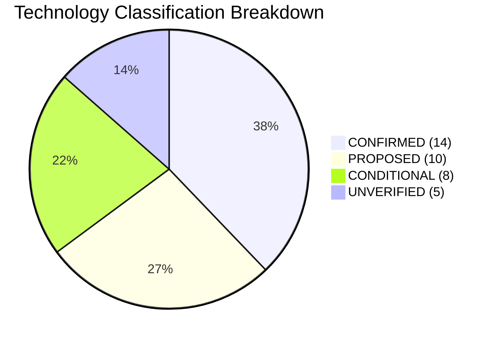

# FioriX Technology Feasibility Register & Platform Evaluation
**Project:** FioriX — SAP S/4HANA On-Premise Fiori App Discovery, Assessment and Generation Platform  
**Document Version:** 1.0.0  
**Phase:** Pre-Development / R&D Governance Phase  

---

## 1. Classification Methodology

Every technology, service, framework, protocol, and interface identified across the FioriX specification pack is categorized and evaluated against established SAP documentation and enterprise platform standards.

Each item is assigned one of four definitive feasibility classifications:

| Classification | Definition | Project Policy |
|---|---|---|
| **CONFIRMED** | Standard, proven SAP or industry technology with comprehensive public documentation, standard BTP service availability, and predictable runtime behavior. | Adopt as core architectural foundation; implement immediately according to standard patterns. |
| **PROPOSED** | Architecturally sound and technically feasible, but specific integration patterns, bindings, or configuration details remain unverified in this tenant/project context. | Requires technical spike or proof-of-concept in Sprint 1 before full development commitment. |
| **CONDITIONAL** | Dependent on external commercial licensing, BTP tenant entitlements, quota allocations, or specific on-premise infrastructure prerequisites. | Proceed only if prerequisites are confirmed; otherwise, implement mandatory fallback path. |
| **UNVERIFIED** | Relies on assumptions regarding unpublished SAP APIs, dynamic ABAP behavior, or unproven cross-network capabilities that cannot be accepted without hands-on testing. | Strict discovery gate; do not write dependent code until empirical proof is obtained in an SAP sandbox. |

---

## 2. Master Technology Feasibility Matrix



### 2.1 Runtime, Platform & Core Backend

| Technology / Component | Category | Classification | Architectural Purpose | Feasibility Assessment & Assumptions | Constraints, Dependencies & Risks | Sprint 1 Required Evidence |
|---|---|---|---|---|---|---|
| **SAP BTP Cloud Foundry** | Runtime | **CONFIRMED** | Primary container runtime hosting CAP backend and UI approuter. | Standard multi-tenant CF environment. Reliable standard runtime. | Memory limits per space, 120s HTTP routing timeout, container restarts wipe local storage. | Confirm CF organization, space quota (min. 4 GB RAM), and region. |
| **SAP CAP (Node.js/TypeScript)** | Backend Framework | **CONFIRMED** | Core business logic, domain APIs, persistence orchestration, authorization. | `@sap/cds` provides mature support for TypeScript, HANA DB, and XSUAA integration. | Async workers require careful process separation to avoid event loop starvation. | Successful execution of basic `@sap/cds` local and CF build. |
| **CAP CDS (`@sap/cds`)** | Data Modeling | **CONFIRMED** | FioriX metadata domain model definition and compilation to HANA DDL. | Highly standardized, reliable DDL compiler for HANA Cloud. | Distinct from ABAP CDS; cannot be used interchangeably. | Compile `docs/14` schema definitions using `cds compile`. |
| **SAP HANA Cloud** | Database | **CONFIRMED** | Persistent relational storage for FioriX metadata, assessments, and audit logs. | Native backing database for CAP via HDI containers. | Sizing costs; JSON column querying limits; memory consumption for large snapshots. | Confirm provisioned HDI container instance and subaccount binding. |
| **TypeScript / Node.js 20 LTS** | Language & Runtime | **CONFIRMED** | Type-safe development for backend services and generator templates. | Standard LTS runtime supported by CF Node.js buildpack. | Build step required (`tsc`); potential buildpack version mismatches. | Check buildpack compatibility in target BTP CF landscape. |
| **BTP Managed App Router** | Ingress & Security | **CONFIRMED** | Authentication entry point, route forwarding, CSRF handling. | Standard SAP BTP ingress pattern; eliminates custom router container maintenance. | Limited custom middleware support compared to standalone approuter. | Test managed approuter routing to mock CAP service in CF. |

---

### 2.2 SAP Frontend Technologies

| Technology / Component | Category | Classification | Architectural Purpose | Feasibility Assessment & Assumptions | Constraints, Dependencies & Risks | Sprint 1 Required Evidence |
|---|---|---|---|---|---|---|
| **SAPUI5 Freestyle** | Frontend Framework | **CONFIRMED** | FioriX platform workbench interface (Explorer, Studio, Validation). | Mature UI library with comprehensive enterprise controls and accessibility. | Requires custom MVC controllers and models; higher dev effort than Fiori Elements. | Verify UI5 library version (min. 1.120 LTS) in HTML5 repository. |
| **SAP Fiori Elements (Draft App)** | Generated Target | **PROPOSED** | Target architecture for generated custom draft applications. | Standard floorplans (List Report & Object Page) driven by OData annotations. | Generated annotations must match target S/4HANA release and UI5 version exactly. | Offline generation test of List Report manifest and annotations. |
| **HTML5 Application Repository** | UI Hosting | **CONFIRMED** | Storage and versioning of FioriX frontend static UI assets. | Standard BTP service (`html5-apps-repo`) integrating with App Router. | Deployment requires MTA or UI5 Tooling Cloud Foundry deployment plugin. | Verify service plan entitlements (`app-host`, `app-runtime`). |
| **UI5 Tooling (`@ui5/cli`)** | Build Tooling | **CONFIRMED** | Building, bundling, and linting SAPUI5 applications. | Standard build toolchain maintained by SAP open-source community. | Package dependencies and custom build tasks must be maintained. | Execute sample `ui5 build` and `ui5 lint`. |

---

### 2.3 SAP Connectivity & Integration Interfaces

| Technology / Component | Category | Classification | Architectural Purpose | Feasibility Assessment & Assumptions | Constraints, Dependencies & Risks | Sprint 1 Required Evidence |
|---|---|---|---|---|---|---|
| **SAP BTP Destination Service** | Connectivity | **CONFIRMED** | Manages credentials, tokens, and endpoints for on-premise S/4HANA. | Core BTP foundation service; handles proxy token exchange. | Destination names must match across environments; certificate management. | Create test destination to S/4HANA sandbox and execute ping. |
| **SAP BTP Connectivity Service** | Connectivity | **CONFIRMED** | Bridges Cloud Foundry container to SAP Cloud Connector tunnel. | Standard BTP service bound to CAP application. | Requires SOCKS5 / HTTP proxy handling via `@sap-cloud-sdk/connectivity`. | Verify service binding and proxy environment variables (`HTTP_PROXY`). |
| **SAP Cloud Connector (SCC)** | On-Premise Tunnel | **CONFIRMED** | Secure reverse-proxy tunnel from on-premise DMZ to BTP subaccount. | Established enterprise connectivity bridge; zero inbound firewall ports. | Administrator rights required on-premise to map virtual hosts and URL paths. | Validate SCC connected status in BTP cockpit; check resource path mappings. |
| **ADT REST/XML Resources** | SAP Interface | **PROPOSED** | Discovering programs, packages, CDS views, and where-used graphs. | Primary mechanism used by ABAP Development Tools in Eclipse (`/sap/bc/adt/*`). | Undocumented REST schemas; proprietary XML payloads; may change across releases. | Execute Node.js HTTP call to `/sap/bc/adt/discovery` and parse XML response. |
| **T-Code Metadata Tables (TSTC/TADIR)** | SAP Data Source | **PROPOSED** | Extracting transaction definitions, linked programs, and packages. | Foundation of transaction catalog in SAP NetWeaver / ABAP Platform. | Direct table read requires `S_TABU_DIS` / RFC or custom read-only gateway. | Verify whether target system permits reading TSTC via ADT or custom service. |
| **OData Catalog Services (V2/V4)** | Service Discovery | **PROPOSED** | Querying published OData services (`IWFND/CATALOGSERVICE`, `/iwbep/catalog`). | Standard SAP Gateway catalog interfaces. | Services must be active; V4 catalog structure differs drastically from V2. | Execute GET query against catalog service in S/4HANA DEV system. |
| **Authorization Tables (USOBX_C, USOBT_C)** | Security Discovery | **PROPOSED** | Identifying required authorization objects linked to transactions. | Stores SU22/SU24 transaction-to-authorization-object proposals. | Client-dependent; requires authorization to inspect security tables. | Validate availability of SU24 proposal data for pilot transaction. |
| **ABAP Source Inspection via ADT** | Code Discovery | **CONDITIONAL** | Reading program/class source code for include/dependency extraction. | Available via `/sap/bc/adt/programs/programs/{name}/source/main`. | Security risk: high-security organizations frequently ban automated code export. | Secure written sign-off from SAP Security Architect for read-only access. |
| **ADT Where-Used Cross-References** | Dependency Graph | **UNVERIFIED** | Determining downstream tables, views, and classes used by a program. | Provided by `/sap/bc/adt/repository/crossreferences`. | Highly resource-intensive; may cause CPU spikes or timeouts on large programs. | Benchmark where-used execution time on pilot transaction in DEV. |

---

### 2.4 SAP Target Generation Stack (S/4HANA-Side)

| Technology / Component | Category | Classification | Architectural Purpose | Feasibility Assessment & Assumptions | Constraints, Dependencies & Risks | Sprint 1 Required Evidence |
|---|---|---|---|---|---|---|
| **ABAP CDS View Entities** | Target Artifact | **CONFIRMED** | Modern semantic data model generated for custom application drafts. | Standard on S/4HANA 2020+. Replaces obsolete `DEFINE VIEW` (DDIC-based). | Syntax differences between S/4HANA 1909 and 2022/2023. | Pin exact target S/4HANA release version before generating DDL. |
| **RAP Behavior Definition (BDEF)** | Target Artifact | **PROPOSED** | Business object logic (CRUD, validations, actions) for custom app. | Core of SAP RESTful Application Programming Model. | Syntax and features (Managed vs Unmanaged) vary significantly by release. | Confirm whether target release supports Managed RAP with draft handling. |
| **Service Definition (SRVD)** | Target Artifact | **CONFIRMED** | Exposes specific ABAP CDS entities for consumption in a service. | Standard RAP artifact; clean, simple DDL syntax. | Requires matching CDS entities; must adhere to Clean Core naming. | Generate sample SRVD text artifact and verify syntax against release docs. |
| **Service Binding (SRVB)** | Target Artifact | **PROPOSED** | Binds Service Definition to protocol (OData V4 - UI or Web API). | Standard RAP mechanism for publishing endpoints. | Automatic generation of SRVB is complex; activation requires SAP Gateway. | Document manual activation steps for customer developers in draft README. |
| **ABAP Test Cockpit (ATC)** | Quality Gate | **CONDITIONAL** | Verifying Clean Core compliance, syntax errors, and naming conventions. | Standard ABAP code analysis tool in S/4HANA. | Requires target system ATC variant configuration; requires SAP-side execution. | Inspect ATC baseline rules and available check variants on target system. |
| **SAP Transport / CTS / abapGit** | Lifecycle / Transport | **CONDITIONAL** | Importing generated draft artifacts into S/4HANA developer sandbox. | Standard transport management (`SE09`/`SE10`) or open-source abapGit. | FioriX explicitly does NOT automate transport creation; requires human dev. | Define draft export format (abapGit repository layout vs. plain text ZIP). |

---

### 2.5 Catalog & External Services

| Technology / Component | Category | Classification | Architectural Purpose | Feasibility Assessment & Assumptions | Constraints, Dependencies & Risks | Sprint 1 Required Evidence |
|---|---|---|---|---|---|---|
| **FAL Ingestion (Scraping/Direct API)** | Catalog | **UNVERIFIED** | Automated live synchronization of standard Fiori apps from `fal.cloud.sap`. | Assumed live automated ingestion. **Reality: No public REST API exists.** | Scraping violates SAP ToS and breaks on website redesigns. | **REJECT LIVE SCRAPER.** Adopt curated offline FAL export workflow. |
| **Curated Offline FAL Dataset** | Catalog | **CONFIRMED** | Baseline catalog of standard SAP Fiori apps seeded into HANA Cloud. | Uses officially supported FAL Excel/CSV/JSON export mechanisms. | Data is point-in-time; requires manual periodic refresh. | Successfully export and parse official FAL dataset for pilot business domain. |
| **Semantic Embedding Search** | Retrieval Engine | **PROPOSED** | Fuzzy matching of business requirements against Fiori catalog capabilities. | Vector search over app descriptions and intent words using HANA Vector Engine. | Requires vector engine entitlement and embedding generation service. | Compare deterministic keyword matching vs. vector search accuracy in Sprint 2. |

---

### 2.6 BTP Supporting Services & Infrastructure

| Technology / Component | Category | Classification | Architectural Purpose | Feasibility Assessment & Assumptions | Constraints, Dependencies & Risks | Sprint 1 Required Evidence |
|---|---|---|---|---|---|---|
| **SAP Document Management Service (DMS)**| Storage | **CONDITIONAL** | Storing generated draft project ZIP files and specification documents. | SAP standard for document storage; CMIS compliant. | Entitlement/cost dependent; requires S3/Azure storage repository binding. | Export BTP subaccount entitlements to verify `sdm` service plan. |
| **HANA Cloud LOB Fallback Storage** | Storage (Fallback) | **CONFIRMED** | Fallback storage for generated draft files if DMS is not entitled. | Relational `LargeString` / `BLOB` tables within existing HANA Cloud instance. | Sizing impact; should not be used for massive binary storage (>10 MB). | Benchmark LOB read/write performance in CAP for 5 MB ZIP archive. |
| **SAP Application Logging Service** | Observability | **CONDITIONAL** | Centralized log indexing, search, and alerting for CF microservices. | Standard CF logging infrastructure (`cf-nodejs-logging-support`). | Optional premium service; standard `cf logs` available without cost. | Check entitlement; if absent, format logs as structured JSON to stdout. |
| **SAP Audit Log Service** | Governance | **CONDITIONAL** | Tamper-proof logging of security events (authentication, role assignment). | Premium compliance service on SAP BTP. | Configuration overhead; not needed for internal domain-level business logs. | Check entitlement. Maintain custom `AUDIT_EVENT` table in HANA Cloud. |
| **SAP AI Core & GenAI Hub** | AI/ML | **CONDITIONAL** | Advisory extraction of business requirements and code explanations. | Governed SAP AI access to large language models (Azure OpenAI, etc.). | Costly consumption units; requires AI Core tenant and model deployment. | Export subaccount entitlements; maintain fully mockable AI adapter interface. |
| **External AI Provider (Direct API)** | AI/ML (Fallback) | **CONDITIONAL** | Direct integration with OpenAI / Azure OpenAI / Anthropic / Google Cloud. | Feasible via standard HTTPS REST calls from Node.js backend. | High compliance barrier: corporate policy often bans sending code to external LLMs. | Require written corporate data privacy and security clearance before enabling. |

---

## 3. Technology Risk Summary & Required Sprint 1 Actions

```
+---------------------------------------------------------------------------------------+
| GATING ACTION 1: REJECT FAL AUTOMATED SCRAPING                                         |
| -> Replaced by Curated Offline FAL Export (Export -> Clean -> HANA Seed)              |
+---------------------------------------------------------------------------------------+
| GATING ACTION 2: VALIDATE ADT REST PROTOCOL OVER CLOUD CONNECTOR                      |
| -> Execute technical spike in Sprint 1 to negotiate /sap/bc/adt/discovery            |
+---------------------------------------------------------------------------------------+
| GATING ACTION 3: FORMAL LEAST-PRIVILEGE SAP ROLE SPECIFICATION                        |
| -> Deliver Z_FIORIX_DISCOVERY_RO specifying exact authorization objects               |
+---------------------------------------------------------------------------------------+
| GATING ACTION 4: CONFIRM STORAGE FALLBACK ARCHITECTURE                                |
| -> Verify DMS entitlement; configure CAP HANA LOB fallback adapter                   |
+---------------------------------------------------------------------------------------+
```

This register must be re-evaluated at the conclusion of Sprint 1 to transition PROPOSED and CONDITIONAL technologies to CONFIRMED status prior to Sprint 2 execution.
