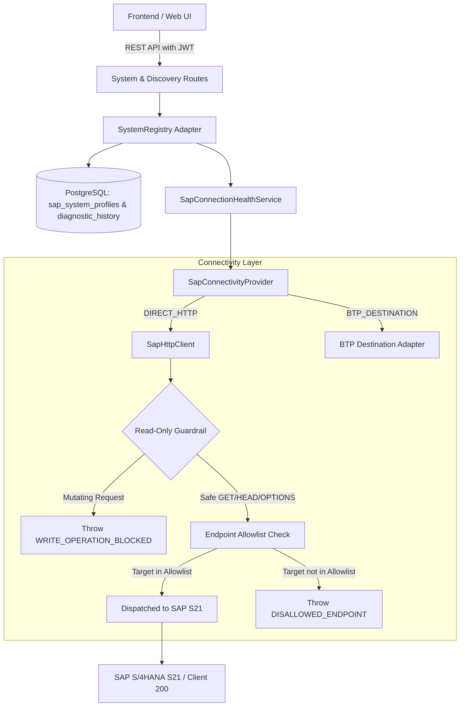

# Fiorify — SAP Connectivity Architecture

**Document Type:** Technical Architecture Specification  
**Sprint:** S2 (SAP Landscape & Local Connectivity Foundation)  
**Standard:** Enterprise SAP S/4HANA & Node.js Integration Standard

---

## 1. Architectural Overview

Fiorify interacts with SAP S/4HANA systems strictly for read-only discovery, metadata inspection, and compatibility verification. The connectivity subsystem provides a layered, secure architecture separating network protocol handling from business domain logic.



---

## 2. Key Components

### 2.1. `SapHttpClient` (`backend/src/infrastructure/connectivity/sapHttpClient.js`)
The hardened core of outbound HTTP communication:
- **Strict Read-Only Enforcement:** Methods `POST`, `PUT`, `DELETE`, `PATCH` throw a deterministic runtime exception before dispatching network packets.
- **Endpoint Allowlisting:** Outbound URLs must match approved SAP service prefixes:
  - `/sap/opu/odata/` (OData V2 Gateway Services)
  - `/sap/opu/odata4/` (OData V4 Gateway Services)
  - `/sap/bc/adt/` (ABAP Development Tools Discovery & Search)
  - `/sap/bc/echo` (ICM Reachability Ping)
  - `/sap/public/bc/` (Public Discovery Services)
- **Credential Hygiene:** All outgoing headers and incoming logs strip `Authorization`, `x-csrf-token`, and cookie tokens.
- **Traceability:** Automatic injection of `x-correlation-id` and `x-request-id` headers.

### 2.2. `SapConnectivityProvider` (`backend/src/infrastructure/connectivity/sapConnectivityProvider.js`)
Provides connection polymorphism:
- **`DIRECT_HTTP` Mode:** Directly connects to SAP Gateway endpoint using HTTP Basic Authentication or SAP Single Sign-On ticket.
- **`BTP_DESTINATION` Mode:** Resolves BTP destinations via SAP Cloud SDK, fetching OAuth tokens and routing through the SAP Cloud Connector tunnel.

### 2.3. `SapConnectionHealthService` (`backend/src/infrastructure/connectivity/sapConnectionHealthService.js`)
Performs a comprehensive multi-point capability probe:
1. `SYSTEM_ECHO`: Basic ICM reachability (`/sap/bc/echo`).
2. `AUTHENTICATION`: Distinction between valid user and HTTP 401.
3. `GATEWAY_CATALOG`: Verification of OData catalog (`/IWFND/CATALOGSERVICE;v=2`).
4. `ADT_DISCOVERY`: Detection of ABAP Development Tools support (`/sap/bc/adt/discovery`).
5. `READ_ONLY_BOUNDARIES`: In-memory verification that write operations are rejected.
6. `RELEASE_VERIFICATION`: Identifies S/4HANA release (target `S4CORE 108`).

### 2.4. `SapSystemRepository` (`backend/src/infrastructure/db/repositories/sapSystemRepository.js`)
Provides PostgreSQL persistence for SAP system profiles and immutable diagnostic history:
- Managed table: `sap_system_profiles` (schema migration `004`).
- Managed table: `sap_system_diagnostic_history` (schema migration `004`).
- Strict tenant isolation: Every query is bounded by `tenant_id`.
- Zero password persistence: Plaintext passwords are never persisted to the database.

---

## 3. Error Taxonomy & Non-Conflation Guarantee

A critical engineering standard of Fiorify is the strict separation between infrastructure errors and functional transaction availability:

```
+-------------------------------------------------------------+
|                     Request Execution                       |
+-------------------------------------------------------------+
                               |
               +---------------+---------------+
               |                               |
       HTTP 200 OK                     HTTP 4xx / 5xx
               |                               |
     +---------+---------+             +-------+-------+
     |                   |             |               |
Object Found      Object Not Found   401/403        502/503/504
     |                   |             |               |
App Available      Missing T-Code  Security Fail  Infrastructure Fail
(Catalogue Match)  (Valid BUILD)   (No Decision)  (No Decision)
```

> [!IMPORTANT]
> If a request fails due to `401 Unauthorized`, `403 Forbidden`, `502 Bad Gateway`, or `504 Gateway Timeout`, downstream assessment engines **MUST NOT** classify the transaction as "custom development required (BUILD)".
> The status is classified strictly as `SECURITY_BLOCKED` or `CONNECTIVITY_FAILURE`.
