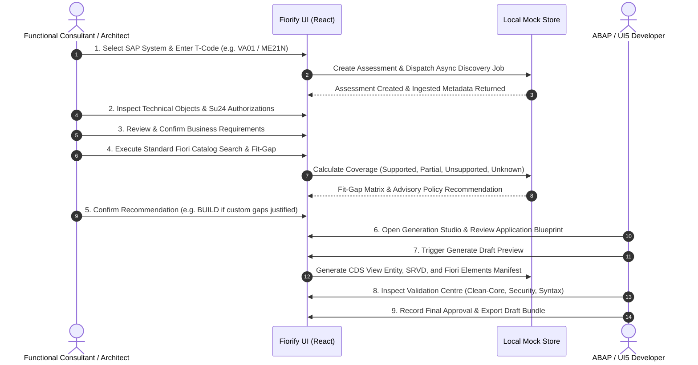

# Fiorify User Workflows & Journey Specifications
**Project:** Fiorify — SAP S/4HANA On-Premise Fiori App Discovery, Assessment and Controlled Generation Platform  
**Document Version:** 1.0.0  
**Phase:** Sprint 1 Frontend Implementation  

---

## 1. End-to-End User Journey Overview

---

## 2. Detailed Workflow Specifications

### Workflow 1: SAP System Registration & Simulated Health Probe
1. User navigates to `/systems` and clicks **Add System**.
2. Modal opens requiring:
   - System Alias (e.g., `S4H_DEV_100`)
   - Environment (`Development`, `Quality`, `Sandbox`, `Production`)
   - Destination Reference (`S4H_DEV_ONPREM`)
   - Target Release Profile (`S/4HANA 2022 FPS02` or `S/4HANA 2023`)
3. User triggers **Test Connection**:
   - The UI displays an explicit badge: `SIMULATED LOCAL TEST`.
   - Simulates Cloud Connector latency (800ms) and returns verified capability tags (`ADT Ready`, `OData V4 Active`, `RFC Restricted`).
4. System record is added to the active table and persisted locally.

### Workflow 2: Transaction Code Discovery & Exploration
1. User navigates to `/explorer`.
2. User filters by SAP Module (`SD`, `MM`, `FI`, `CO`) or enters a T-Code (e.g., `VA01`).
3. Results table displays:
   - T-Code, Description, Program, Package, Object Type (`Standard` vs `Custom`), and Assessment Status.
4. User clicks a row to open the `/explorer/:tcode` Object Page:
   - Header shows program name (`SAPMV45A`), package (`VA`), and provenance (`VERIFIED METADATA`).
   - Tabs allow drill-down:
     - **Overview:** Main transaction attributes and transaction variant info.
     - **Programs & Includes:** Associated subroutines and include hierarchy.
     - **Database & CDS:** Underlying tables (`VBAK`, `VBAP`) and CDS views (`I_SalesOrder`).
     - **Authorizations:** SU24 checks (`V_VBAK_VKO`, `V_VBAK_AAT`).
     - **Evidence:** Source timestamp, interface endpoint, and confidence score.

### Workflow 3: New Assessment Creation (Wizard)
1. User clicks **New Assessment** (`/assessments/new`).
2. **Step 1 - Select System:** Dropdown selects active registered SAP system.
3. **Step 2 - Transaction Input:** Single T-Code entered with instant format validation.
4. **Step 3 - Scope Definition:** Select analysis depth (`Standard Discovery`, `Deep Where-Used`, `Include Security Profile`).
5. **Step 4 - Review Evidence Constraints:** Confirms read-only access and acknowledges that dynamic calls remain `UNKNOWN`.
6. **Step 5 - Review & Create:** Summary view with **Create Assessment** button. Dispatches background scan job and redirects to the full Assessment Workspace.

### Workflow 4: Assessment Workspace (The Core 9-Stage Workbench)
Located at `/assessments/:id`, this is the heart of Fiorify:
- **Tab 1: Overview:** Executive summary, system info, assessment progress, and current stage badge.
- **Tab 2: Technical Analysis:** Interactive tree and table of discovered SAP DDIC and repository objects with evidence levels.
- **Tab 3: Business Context:** Business process documentation (`Order-to-Cash`), actors, activities, and process flow.
- **Tab 4: Requirements:** Confirmed business rules, validations, inputs/outputs. Users can add or edit requirements via modal dialogs.
- **Tab 5: Fiori Discovery:** Candidate standard SAP Fiori apps ranked by relevance.
- **Tab 6: Fit-Gap Analysis:** Side-by-side comparison matrix. Each requirement is scored as `SUPPORTED`, `PARTIAL`, `UNSUPPORTED`, or `UNKNOWN`.
- **Tab 7: Recommendation:** Evaluates policy:
  - If all critical requirements met $\rightarrow$ `ADOPT`
  - If minor gap with supported BAdI $\rightarrow$ `EXTEND`
  - If core gap with verified custom logic $\rightarrow$ `BUILD`
  - If requirements or evidence incomplete $\rightarrow$ `REVIEW`
- **Tab 8: Generation Blueprint:** Unlocked only when decision is `BUILD`. Displays the data model, CDS view proposal, and floorplan configuration.
- **Tab 9: Audit History:** Chronological, tamper-evident log of changes made to this assessment.

### Workflow 5: Generation Studio & Draft Artifact Inspection
1. User opens `/generation` or navigates to Tab 8 from an approved assessment.
2. The Generation Studio presents a structured application blueprint:
   - Application Pattern (`List Report & Object Page`)
   - OData V4 Service Proposal (`ZSD_SALESORDER_V4`)
   - Primary Entity & Key Structure
   - Fields, UI Annotations, and Line Item Facets
3. User clicks **Generate Draft Blueprint**:
   - A confirmation dialog informs the user that draft artifacts will be generated in reviewable format.
   - Generates mock project files: `manifest.json`, `Z_I_SalesOrder.cds`, `ZSD_SalesOrder.srvd`, and `annotations.cds`.
4. User inspects generated artifacts in a syntax-highlighted code viewer with an **Export Draft ZIP** action.

### Workflow 6: Validation Centre & Governance Sign-Off
1. User navigates to `/validation`.
2. Inspects multi-category validation checks:
   - Architecture & Naming Conventions
   - Clean-Core Tier 1 Compliance
   - Security & Authorization Constraints
   - Release Syntax Compatibility
3. Each check lists status (`PASS`, `WARNING`, `FAIL`), evidence, and remediation suggestions.
4. User navigates to `/approvals` to record formal architectural sign-off before exporting any draft to an S/4HANA sandbox.
